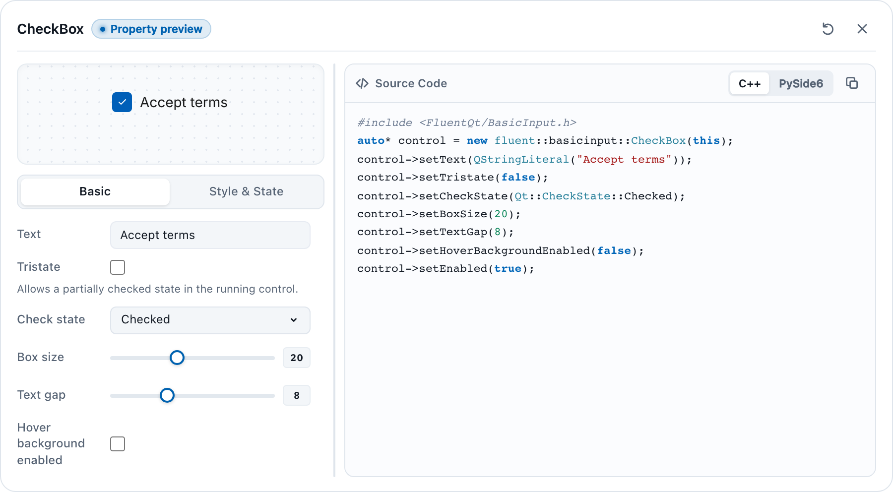
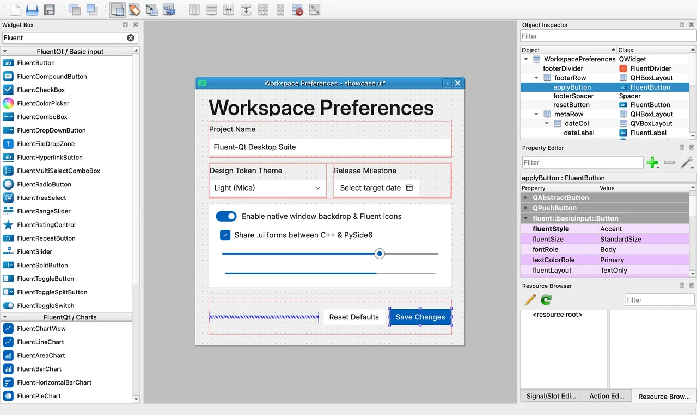

<p align="center">
  <a href="README.md">English</a> | <a href="README.zh-CN.md">简体中文</a> | <a href="README.zh-TW.md">繁體中文</a> | <a href="README.ja.md">日本語</a> | <a href="README.ko.md">한국어</a> | Deutsch | <a href="README.ru.md">Русский</a> | <a href="README.es.md">Español</a> | <a href="README.fr.md">Français</a>
</p>

<p align="center">
  
</p>

<h1 align="center">Fluent-Qt</h1>

<p align="center">
  MIT-lizenzierte native Fluent-UI-Komponentenbibliothek für Qt Widgets — eine gemeinsame C++17-Implementierung für C++, PySide6 und WebAssembly.
</p>

<p align="center">
  <a href="https://github.com/calvinhxx/Fluent-Qt/actions/workflows/ci.yml"></a>
  <a href="https://github.com/calvinhxx/Fluent-Qt/stargazers"></a>
  <a href="LICENSE"></a>
  
  
  
  
  <a href="bindings/pyside6/README.md"></a>
  <a href="https://pypi.org/project/FluentQt/"></a>
</p>

<p align="center">
  <a href="https://calvinhxx.github.io/Fluent-Qt/de/#gallery"></a>
</p>

<p align="center">
  <strong><a href="https://calvinhxx.github.io/Fluent-Qt/de/#gallery">Live-C++-Web-Gallery testen</a></strong>
  ·
  <strong><a href="https://calvinhxx.github.io/Fluent-Qt/studio/?lang=en">Page Studio</a></strong>
  ·
  <strong><a href="https://calvinhxx.github.io/Fluent-Qt/de/api/checkbox/?playground=1">Eigenschaftsvorschau</a></strong>
  ·
  <a href="https://calvinhxx.github.io/Fluent-Qt/de/api/">Doku &amp; API</a>
  ·
  <a href="https://calvinhxx.github.io/Fluent-Qt/de/#top">Projekt-Website</a>
  ·
  <a href="https://github.com/calvinhxx/Fluent-Qt/discussions">Fragen &amp; Community</a>
  ·
  <a href="https://calvinhxx.github.io/Fluent-Qt/de/#support">Projekt unterstützen</a>
</p>

Fluent-Qt (FluentQt) bringt Fluent UI über eine einzige native C++17-Codebasis auf Qt Widgets für C++, PySide6 und WebAssembly:

- **MIT-Lizenz für kommerzielle und Open-Source-Apps** — die C++17-Bibliothek, die PySide6-Bindings, das Qt-Designer-Plugin und die Projektstarter stehen unter der MIT-Lizenz.
- **Eine native C++17-Implementierung** — 99 Gallery-Einträge wie `DataGrid`, [Diagramme](docs/architecture/charts.md), Navigation, Overlays, Dialoge und Fenster nutzen dieselben C++17-Widgets in C++ (`Qt 5.15+` / `6.2+`), `PySide6` und `WebAssembly` statt reiner Stylesheet-Skins.
- **Visuelles Design & gemeinsame `.ui`-Formulare** — Oberflächen im Browser mit **Page Studio** gestalten (Export als C++, PySide6 oder `.ui`) oder direkt in **Qt Creator** und `pyside6-designer` mit 95 Widget-Box-Einträgen und 4 Vorlagen arbeiten.
- **App-Starter & KI-GUI-Skill** — geschichtete `monitor`-, `workbench`- und `existing-qt`-Projekte per `python3 tools/onboarding/fluentqt` erzeugen oder Benutzeroberflächen mit [`build-fluentqt-gui`](.agents/skills/build-fluentqt-gui/SKILL.md) erstellen.
- **Optionale Erweiterungsmodule** — gewöhnliche 2D-Apps hängen nur von `Qt Widgets` ab; CPU-Partikelhintergründe ([Particles](docs/architecture/particles.md)), 3D-Perspektivansichten ([Spatial](docs/architecture/spatial-view.md)) und eingebettete QML-Seiten ([QmlBridge](docs/architecture/qml-bridge.md)) werden nur bei Bedarf aktiviert.

## 🧩 Bibliotheksmodule

| Modul | CMake-Target | Zweck |
|---|---|---|
| Core | `FluentQt::FluentQt` | Alle 2D-Steuerelemente, Themes, Typografie, Layout-Helfer und Diagramme. Normale 2D-Apps benötigen nur dieses Target. |
| [Plugins](docs/architecture/plugins.md) | `FluentQt::Plugins` | In-Process-Plugin-Registrierung, Abhängigkeitsreihenfolge, Aktivierung und Bereinigung. |
| [Particles](docs/architecture/particles.md) | `FluentQt::Particles` | CPU-gerenderte animierte Partikel-Hintergründe (`ParticleBackdrop`, kein OpenGL nötig) sowie `ParticlesSession` zum Pausieren/Fortsetzen. |
| [Spatial](docs/architecture/spatial-view.md) | `FluentQt::Spatial` | Verleiht bestehenden `QWidget`-Layouts räumliche Perspektive. Schlagen Sitzungsstart oder Ansichtserstellung fehl, stellt die App ein [2D-Layout](examples/hello_world/README.md) bereit. |
| [QmlBridge](docs/architecture/qml-bridge.md) | `FluentQt::QmlBridge` | `QmlView` zum Einbetten von QML-Seiten in Widgets-Fenster bei gemeinsam genutzten App-Modellen und Fluent-Themes. |

C++-Apps verlinken diese Targets direkt, Python-Apps nutzen die passenden PySide6-Module und WebAssembly kompiliert denselben C++-Code für den Browser. Probiere die Erweiterungsbeispiele in der Gallery unter **Plugins → Particles**, **Plugins → Spatial** (**Settings → 3D Gallery** aktivieren) und **Plugins → QmlBridge → QmlView**, oder wirf einen Blick in das [minimale QML-Beispiel](examples/qml_bridge/).

## 🖼 Gallery & Online-Dokumentation

Nutze die Gallery, um Steuerelemente zu durchsuchen, Interaktionen auszuprobieren und C++- sowie Python-Beispielcode zu lesen.

| Ausprobieren auf | Einstiegspunkt |
|---|---|
| Browser (WebAssembly Gallery) | [Live-Gallery](https://calvinhxx.github.io/Fluent-Qt/gallery/) · [Projekt-Website](https://calvinhxx.github.io/Fluent-Qt/de/#gallery) |
| Online-Doku & Eigenschaftsvorschau | [Komponenten-Doku & API](https://calvinhxx.github.io/Fluent-Qt/de/api/) · [Eigenschaftsvorschau testen](https://calvinhxx.github.io/Fluent-Qt/de/api/checkbox/?playground=1) |
| Windows, macOS, Linux | [Gallery-Paket herunterladen](https://github.com/calvinhxx/Fluent-Qt/releases/latest) |

### Komponenten-Doku & Eigenschaftsvorschau

Die [Online-Dokumentation](https://calvinhxx.github.io/Fluent-Qt/de/api/) enthält die Grundlagen, die API-Referenz für die Komponenten und die [Versionshinweise](https://calvinhxx.github.io/Fluent-Qt/de/api/releases/) auf Deutsch. Öffne auf einer Komponentenseite **Eigenschaftsvorschau**, um echte Qt-Eigenschaften anzupassen und den erzeugten C++- oder PySide6-Code zu kopieren:

<p>
  <a href="https://calvinhxx.github.io/Fluent-Qt/de/api/checkbox/?playground=1">
    
  </a>
</p>

Schnelleinstieg: [Button](https://calvinhxx.github.io/Fluent-Qt/de/api/button/?playground=1) · [CheckBox](https://calvinhxx.github.io/Fluent-Qt/de/api/checkbox/?playground=1) · [ComboBox](https://calvinhxx.github.io/Fluent-Qt/de/api/combobox/?playground=1) · [DataGrid](https://calvinhxx.github.io/Fluent-Qt/de/api/data-grid/?playground=1) · [LineChart](https://calvinhxx.github.io/Fluent-Qt/de/api/line-chart/?playground=1) · [ParticleBackdrop](https://calvinhxx.github.io/Fluent-Qt/de/api/particle-backdrop/?playground=1) · [SpatialView](https://calvinhxx.github.io/Fluent-Qt/de/api/spatial-view/?playground=1) · [QmlView](https://calvinhxx.github.io/Fluent-Qt/de/api/qml-view/?playground=1)

### Python Gallery

Installiere die Python Gallery über [PyPI](https://pypi.org/project/FluentQt-Gallery/) (die passende `FluentQt`-Version wird automatisch mitinstalliert):

```bash
python -m pip install FluentQt-Gallery
python -m fluentqt_gallery
```

## 🎨 Visuelles Design

- **Page Studio (Web)**: Ordne Fluent-Qt-Steuerelemente im Browser mit [Page Studio](https://calvinhxx.github.io/Fluent-Qt/studio/?lang=en) per Drag-and-Drop an, starte aus Vorlagen oder KI-generierten Layouts, teste Interaktionen live und exportiere C++-, PySide6- oder Qt-Designer-`.ui`-Dateien.

### Qt Designer

Mit allen Modulen bieten Qt Creator und `pyside6-designer` 95 Einträge in der Widget-Box und vier Vorlagen für neue Formulare. Das Kernmodul bietet 92 Einträge und drei Vorlagen. [Designer einrichten](tools/designer/README.md).

<p>
  <a href="tools/designer/README.md">
    
  </a>
</p>

## 🤖 Bauen mit KI

**KI-Skill & Onboarding-CLI**: Nutze den Skill [`build-fluentqt-gui`](.agents/skills/build-fluentqt-gui/SKILL.md) in Codex, Claude Code oder Cursor ([Beispiel](https://calvinhxx.github.io/Fluent-Qt/de/#ai-build) · [Installation & Nutzung](docs/ai/README.md)) und prüfe Umgebungen oder erstelle geschichtete C++-/PySide6-Starter (`monitor`, `workbench`, `existing-qt`) per `python3 tools/onboarding/fluentqt` ([Onboarding-Tools](tools/onboarding/README.md)). Wenn du ein Gallery-Beispiel anpasst, prüfe gespeicherte Änderungen zuerst in der Live Scene, bevor du das kompilierte C++-Beispiel verifizierst ([Funktionsweise](docs/development/gallery-preview-workflow.md)).

```bash
python3 tools/onboarding/fluentqt create my-monitor --language cpp --starter monitor
python3 tools/onboarding/fluentqt create my-py-monitor --language pyside6 --starter monitor
```

## 🚀 Schnelleinstieg

Fluent-Qt läuft nativ sowohl unter **Python (PySide6)** als auch unter **C++17 (CMake)**.

### Python (PySide6)

Die Wheels für Qt/PySide6 6.9.3 unterstützen CPython 3.11–3.13. Linux ARM64 benötigt CPython 3.12–3.13 und glibc ab 2.39.

```bash
python -m pip install FluentQt
```

`main.py`:

```python
import sys
import fluentqt
from PySide6.QtCore import Qt
from PySide6.QtWidgets import QApplication, QVBoxLayout, QWidget
from fluentqt.basicinput import Button
from fluentqt.windowing import Window

fluentqt.prepare_high_dpi_application()
app = QApplication(sys.argv)
fluentqt.initialize_resources()
app.setFont(fluentqt.font_for_role(fluentqt.FontRole.Body))

window = Window()
window.resize(480, 320)
content = QWidget()
button = Button("Hello from FluentQt", content)
button.setFluentStyle(Button.ButtonStyle.Accent)
QVBoxLayout(content).addWidget(button, alignment=Qt.AlignmentFlag.AlignCenter)
window.setContentWidget(content)
window.show()
sys.exit(app.exec())
```

[Python-Guide](bindings/pyside6/README.md) · [Hello World](bindings/pyside6/examples/hello_world/main.py)

### C++-Einrichtung

Die C++-Integration erfordert C++17, CMake 3.16+ und Qt Widgets 5.15+ oder 6.2+. Verwende `FetchContent` für neue Projekte.

#### Integration mit `FetchContent`

```cmake
cmake_minimum_required(VERSION 3.16)
project(my_app LANGUAGES CXX)

set(CMAKE_CXX_STANDARD 17)
set(CMAKE_CXX_STANDARD_REQUIRED ON)

include(FetchContent)
FetchContent_Declare(
    fluentqt
    GIT_REPOSITORY https://github.com/calvinhxx/Fluent-Qt.git
    GIT_TAG v1.12.4
    GIT_SHALLOW TRUE
)
FetchContent_MakeAvailable(fluentqt)

add_executable(my_app main.cpp)
target_link_libraries(my_app PRIVATE FluentQt::FluentQt)
```

#### Quellcode-Integration

Füge nach der Definition deines App-Targets das Fluent-Qt-Quellverzeichnis hinzu und verlinke das exportierte Target:

```cmake
add_subdirectory(Fluent-Qt)
target_link_libraries(my_app PRIVATE FluentQt::FluentQt)
```

#### Integration einer installierten Bibliothek

Nutze eine FluentQt-Installation mit Entwicklungsheadern und CMake-Paketdateien. Siehe die [Anleitung zum Bauen und Installieren der Bibliothek](docs/development/build-workflow.md#install-the-library-or-create-a-source-package).

```cmake
find_package(FluentQt CONFIG REQUIRED)
target_link_libraries(my_app PRIVATE FluentQt::FluentQt)
```

Liegt FluentQt außerhalb des System-Suchpfads, konfiguriere mit `-DCMAKE_PREFIX_PATH=/path/to/fluentqt`.

Wenn du die Abhängigkeiten deiner Qt-6-Anwendung mit vcpkg verwaltest, kannst du die Widgets-Kernbibliothek über den [Overlay-Port für Fluent-Qt](docs/development/build-workflow.md#install-the-widgets-library-with-vcpkg) installieren.

Mit Conan 2 kannst du [die Widgets-Kernbibliothek im lokalen Cache bauen](docs/development/build-workflow.md#build-the-widgets-library-with-conan-2).

#### Minimales C++-Beispiel

`main.cpp`:

```cpp
#include <FluentQt/FluentQt.h>

#include <QApplication>
#include <QVBoxLayout>
#include <QWidget>

int main(int argc, char* argv[])
{
    fluent::prepareHighDpiApplication();
    QApplication app(argc, argv);
    fluent::initializeResources();
    app.setFont(Typography::fontStyle(Typography::FontRole::Body).toQFont());

    fluent::windowing::Window window;
    window.setWindowTitle(QStringLiteral("FluentQt Hello World"));
    window.resize(480, 320);

    auto* content = new QWidget;
    auto* layout = new QVBoxLayout(content);
    layout->setContentsMargins(32, 32, 32, 32);

    auto* button = new fluent::basicinput::Button(
        QStringLiteral("Hello from FluentQt"), content);
    button->setFluentStyle(fluent::basicinput::Button::Accent);
    layout->addStretch();
    layout->addWidget(button, 0, Qt::AlignCenter);
    layout->addStretch();

    window.setContentWidget(content);
    window.show();
    return app.exec();
}
```

Das vollständige Projekt findest du unter [`examples/hello_world`](examples/hello_world/), oder starte das Target `fluentqt_hello_world` direkt aus einer IDE.

## 🛠 Bauen

### Abhängigkeiten

| Bereich | Abhängigkeiten |
|---|---|
| FluentQt C++-Bibliothek | C++17, CMake 3.16+, Qt Widgets 5.15+ oder 6.2+ |
| C++ Gallery | FluentQt, Qt Network, spdlog/fmt |
| C++ WebAssembly | Qt 6.9.3 `wasm_singlethread`, Emscripten 3.1.70 |
| Tests | FluentQt, Qt Test/Network, GTest, spdlog/fmt |
| Optionale PySide6-Bindings | Qt/PySide6/Shiboken6 6.2.4+; Python 3.10+ für Source-Builds |

### Bibliothek

```bash
cmake -S . -B build/fluentqt \
  -DCMAKE_BUILD_TYPE=Release \
  -DCMAKE_PREFIX_PATH=/path/to/Qt
python3 tools/dev/fluent_qt_build.py build/fluentqt --config Release --target FluentQt
cmake --install build/fluentqt --config Release \
  --component Development --prefix /path/to/install
```

Das Build-Skript wählt die Parallelität anhand verfügbarer CPU und Speicher. Siehe den [Build-Workflow](docs/development/build-workflow.md) für Details zur Konfiguration.

### Optionale Erweiterungen

Aktiviere bei der Konfiguration von FluentQt das Plugins-Modul oder eine bestimmte Erweiterung und verlinke anschließend ihr CMake-Target in deiner App:

| Erweiterung | Build-Option | CMake-Target | Integrationsbeispiel |
|---|---|---|---|
| Plugins-Kern | `-DFLUENT_QT_BUILD_PLUGINS=ON` | `FluentQt::Plugins` | [Minimales Plugin-Beispiel](docs/architecture/plugins.md#minimal-extension-example) |
| Plugins → Particles | `-DFLUENT_QT_BUILD_PARTICLES=ON` | `FluentQt::Particles` | [Particles-Integration](docs/architecture/particles.md) |
| Plugins → Spatial | `-DFLUENT_QT_BUILD_SPATIAL=ON` | `FluentQt::Spatial` (schließt Plugins ein) | [Spatial Hello World](examples/hello_world/README.md) |
| Plugins → QmlBridge | `-DFLUENT_QT_BUILD_QML_BRIDGE=ON` | `FluentQt::QmlBridge` (schließt Plugins ein) | [QML-Host-Beispiel](examples/qml_bridge/) |

Setze diese Optionen beim Bau aus den Quellen vor `add_subdirectory()` oder `FetchContent_MakeAvailable()`. Passende Python-Builds stellen die aktivierten Module als `fluentqt.plugins`, `fluentqt.spatial` und `fluentqt.qmlbridge` bereit, und WebAssembly kompiliert dieselbe C++-Implementierung.

### Gallery lokal bauen

Repository-Presets erfordern CMake 3.25+ und `VCPKG_ROOT`. Richte dein Qt-Kit mit der [Ersteinrichtung](docs/development/build-workflow.md#first-use-setup) ein.

Verfügbare Presets auf dem aktuellen Host auflisten:

```bash
cmake --list-presets
```

Unter Apple Silicon `vcpkg-osx` verwenden:

```bash
cmake --preset vcpkg-osx
python3 tools/dev/fluent_qt_build.py \
  --preset vcpkg-osx \
  --target fluent_qt_gallery
```

Auf anderen Plattformen das passende Preset nutzen:

| Plattform | Preset |
|---|---|
| Apple Silicon Mac | `vcpkg-osx` |
| Intel Mac oder Rosetta | `vcpkg-osx-x64` |
| Linux x64 | `vcpkg-linux` |
| Linux ARM64 | `vcpkg-linux-arm64` |
| Windows x64 | `vcpkg-windows` |
| Windows ARM64 | `vcpkg-windows-arm64` |

Verwende für das Packaging das passende `-release`-Preset und die Prüfschritte im [Packaging-Workflow](docs/development/packaging-workflow.md).

### WebAssembly

Details zur Browser-Toolchain, lokalen Builds, Validierung und Pages-Deployment findest du im [WebAssembly-Workflow](docs/development/webassembly-workflow.md).

### Quellpaket

Erstelle das reduzierte Bibliotheks-Quellpaket für Offline- oder Source-Integration:

```bash
python3 tools/dev/fluent_qt_build.py build/fluentqt --target fluent_qt_source_package
```

## 📚 Dokumentation

Starte mit der [Dokumentationsübersicht](docs/README.md) oder springe direkt zum passenden Bereich:

| Ziel | Einstiegspunkt |
|---|---|
| Steuerelemente & API ansehen | [Komponenten-Doku & API](https://calvinhxx.github.io/Fluent-Qt/de/api/) · [WebAssembly Gallery](https://calvinhxx.github.io/Fluent-Qt/de/#gallery) |
| Eine App bauen | [Qt Designer](tools/designer/README.md) · [KI-gestützte Entwicklung](docs/ai/README.md) · [Onboarding-Tools](tools/onboarding/README.md) |
| Zu FluentQt beitragen | [Entwicklungsguides](docs/development/README.md) · [Architektur](docs/architecture/README.md) · [Fluent-Design](docs/design-languages/README.md) |
| Paketieren oder releasen | [Packaging](docs/development/packaging-workflow.md) · [Release-Governance](docs/development/release-governance.md) · [Release-Notes](docs/releases/README.md) |
| Hilfe oder Bugs melden | [Community](docs/community/README.md) · [Support](SUPPORT.md) · [Sicherheit](SECURITY.md) |

Bitte lies vor einem Pull Request [Contributing](CONTRIBUTING.md) und den [Code of Conduct](CODE_OF_CONDUCT.md).

## 🔗 Referenzen

| Quelle | Zweck |
|---|---|
| [Windows UI Kit (Community)](https://www.figma.com/design/qpecbg7hOfos9DcHWeKlfw/Windows-UI-kit--Community-?node-id=2434-129659) | Visuelle Referenz für Fluent / Windows |
| [WinUI Gallery](https://github.com/microsoft/WinUI-Gallery) | Referenz für Steuerungsverhalten und Beispielseiten |

## Lizenz

Der eigene Quellcode von Fluent-Qt steht unter der [MIT License](LICENSE). Gebündelte Assets und paketierte Laufzeitabhängigkeiten behalten ihre jeweiligen Upstream-Lizenzen; Versionen, Herkunft, Quellverfügbarkeit und Lizenzdetails stehen in [THIRD_PARTY_NOTICES.md](THIRD_PARTY_NOTICES.md). Markenrechte und Designreferenzen Dritter behandelt [TRADEMARKS.md](TRADEMARKS.md).
