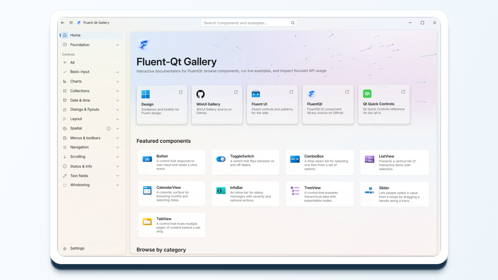

<p align="center">
  <a href="README.md">English</a> | <a href="README.zh-CN.md">简体中文</a> | <a href="README.zh-TW.md">繁體中文</a> | <a href="README.ja.md">日本語</a> | <a href="README.ko.md">한국어</a> | <a href="README.de.md">Deutsch</a> | <a href="README.ru.md">Русский</a> | <a href="README.es.md">Español</a> | Français
</p>

<p align="center">
  
</p>

<h1 align="center">Fluent-Qt</h1>

<p align="center">
  Une bibliothèque multiplateforme de composants UI C++ au style Fluent pour Qt Widgets.
</p>

<p align="center">
  <a href="https://github.com/calvinhxx/Fluent-Qt/actions/workflows/ci.yml"></a>
  <a href="https://github.com/calvinhxx/Fluent-Qt/stargazers"></a>
  <a href="LICENSE"></a>
  
  
  
  
  <a href="https://pypi.org/project/FluentQt/"></a>
</p>

<p align="center">
  <a href="https://calvinhxx.github.io/Fluent-Qt/fr/#top"></a>
</p>

<p align="center">
  <strong><a href="https://calvinhxx.github.io/Fluent-Qt/fr/#gallery">Tester la Web Gallery C++ en direct</a></strong>
  ·
  <strong><a href="https://calvinhxx.github.io/Fluent-Qt/fr/api/checkbox/?playground=1">Aperçu des propriétés</a></strong>
  ·
  <a href="https://calvinhxx.github.io/Fluent-Qt/fr/api/">Docs &amp; API</a>
  ·
  <a href="https://calvinhxx.github.io/Fluent-Qt/fr/#top">Site du projet</a>
  ·
  <a href="https://github.com/calvinhxx/Fluent-Qt/discussions">Questions &amp; communauté</a>
  ·
  <a href="https://calvinhxx.github.io/Fluent-Qt/fr/#support">Soutenir le projet</a>
</p>

Fluent-Qt (FluentQt) fournit des contrôles au style Fluent pour Qt Widgets : saisie, navigation, collections, grilles de données, [graphiques](docs/architecture/charts.md), boîtes de dialogue, popups et fenêtres. Écrite en C++17, la bibliothèque s’intègre aux projets Qt existants via CMake et propose des bindings PySide6 optionnels.

Les applications fonctionnent sous Windows, macOS, Linux et WebAssembly avec les thèmes Clair, Sombre et Contraste élevé ainsi que des modes d’animation configurables. Des modules optionnels ajoutent des arrière-plans de particules ([Particles](docs/architecture/particles.md)), des vues 3D en perspective ([Spatial](docs/architecture/spatial-view.md)) et des pages QML intégrées ([QmlBridge](docs/architecture/qml-bridge.md)).

## 🧩 Modules de la bibliothèque

| Module | Cible CMake | Rôle |
|---|---|---|
| Core | `FluentQt::FluentQt` | Tous les contrôles 2D, thèmes, typographie, utilitaires de mise en page et graphiques. Les apps 2D classiques n’ont besoin que de cette cible. |
| [Plugins](docs/architecture/plugins.md) | `FluentQt::Plugins` | Enregistrement de plugins in-process, ordre des dépendances, activation et nettoyage. |
| [Particles](docs/architecture/particles.md) | `FluentQt::Particles` | Arrière-plans de particules animés rendus sur CPU (`ParticleBackdrop`, sans OpenGL) et pause/reprise via `ParticlesSession`. |
| [Spatial](docs/architecture/spatial-view.md) | `FluentQt::Spatial` | Ajoute de la perspective 3D aux mises en page `QWidget` existantes. Si l’activation de session ou la création de vue échoue, l’app fournit une [mise en page 2D](examples/hello_world/README.md). |
| [QmlBridge](docs/architecture/qml-bridge.md) | `FluentQt::QmlBridge` | `QmlView` pour héberger des pages QML dans Widgets tout en partageant les modèles applicatifs et les thèmes Fluent. |

Les applications C++ lient ces cibles directement, les applications Python utilisent les modules PySide6 correspondants et WebAssembly compile le même code C++ pour le navigateur. Testez les exemples d’extensions dans Gallery sous **Plugins → Particles**, **Plugins → Spatial** (activez **Settings → 3D Gallery**) et **Plugins → QmlBridge → QmlView**, ou consultez l’[exemple QML minimal](examples/qml_bridge/).

## 🖼 Gallery & Documentation en ligne

Utilisez Gallery pour parcourir les contrôles, tester les interactions et lire les exemples de code en C++ et Python.

| Où l’essayer | Point d’entrée |
|---|---|
| Navigateur (WebAssembly Gallery) | [Gallery en direct](https://calvinhxx.github.io/Fluent-Qt/gallery/) · [Site du projet](https://calvinhxx.github.io/Fluent-Qt/fr/#gallery) |
| Documentation & aperçu | [Guides & API](https://calvinhxx.github.io/Fluent-Qt/fr/api/) · [Essayer l’aperçu des propriétés](https://calvinhxx.github.io/Fluent-Qt/fr/api/checkbox/?playground=1) |
| Windows, macOS, Linux | [Télécharger un paquet Gallery](https://github.com/calvinhxx/Fluent-Qt/releases/latest) |

### Documentation des composants & aperçu des propriétés

La [documentation en ligne](https://calvinhxx.github.io/Fluent-Qt/fr/api/) propose en français les guides, la référence des API des composants et les [notes de version](https://calvinhxx.github.io/Fluent-Qt/fr/api/releases/). Ouvrez **Aperçu des propriétés** sur n’importe quelle page de composant pour ajuster les propriétés Qt en direct et copier le code C++ ou PySide6 généré :

<p>
  <a href="https://calvinhxx.github.io/Fluent-Qt/fr/api/checkbox/?playground=1">
    
  </a>
</p>

Accès rapide : [Button](https://calvinhxx.github.io/Fluent-Qt/fr/api/button/?playground=1) · [CheckBox](https://calvinhxx.github.io/Fluent-Qt/fr/api/checkbox/?playground=1) · [ComboBox](https://calvinhxx.github.io/Fluent-Qt/fr/api/combobox/?playground=1) · [DataGrid](https://calvinhxx.github.io/Fluent-Qt/fr/api/data-grid/?playground=1) · [LineChart](https://calvinhxx.github.io/Fluent-Qt/fr/api/line-chart/?playground=1) · [ParticleBackdrop](https://calvinhxx.github.io/Fluent-Qt/fr/api/particle-backdrop/?playground=1) · [SpatialView](https://calvinhxx.github.io/Fluent-Qt/fr/api/spatial-view/?playground=1) · [QmlView](https://calvinhxx.github.io/Fluent-Qt/fr/api/qml-view/?playground=1)

### Python Gallery

Installez la version Python de Gallery depuis [PyPI](https://pypi.org/project/FluentQt-Gallery/) (la version correspondante de `FluentQt` est installée automatiquement) :

```bash
python -m pip install FluentQt-Gallery
python -m fluentqt_gallery
```

## 🤖 Construire avec l’IA

Utilisez le skill [`build-fluentqt-gui`](.agents/skills/build-fluentqt-gui/SKILL.md) dans Codex, Claude Code ou Cursor pour créer une application bureau, ajouter une interface graphique à un projet existant ou peaufiner une UI. [Exemple](https://calvinhxx.github.io/Fluent-Qt/fr/#ai-build) · [Installation et utilisation](docs/ai/README.md)

Lorsque vous ajustez un exemple Gallery, prévisualisez vos modifications enregistrées dans Live Scene avant de vérifier l’exemple C++ compilé. [Fonctionnement](docs/development/gallery-preview-workflow.md)

## 🚀 Démarrage rapide

L’intégration C++ requiert C++17, CMake 3.16+ et Qt Widgets 5.15+ ou 6.2+. Utilisez `FetchContent` pour les nouveaux projets.

### Configuration C++

#### Intégration avec `FetchContent`

```cmake
cmake_minimum_required(VERSION 3.16)
project(my_app LANGUAGES CXX)

set(CMAKE_CXX_STANDARD 17)
set(CMAKE_CXX_STANDARD_REQUIRED ON)

include(FetchContent)
FetchContent_Declare(
    fluentqt
    GIT_REPOSITORY https://github.com/calvinhxx/Fluent-Qt.git
    GIT_TAG v1.12.0
    GIT_SHALLOW TRUE
)
FetchContent_MakeAvailable(fluentqt)

add_executable(my_app main.cpp)
target_link_libraries(my_app PRIVATE FluentQt::FluentQt)
```

#### Intégration par sources

Après avoir défini votre cible applicative, ajoutez le répertoire source de Fluent-Qt et liez la cible exportée :

```cmake
add_subdirectory(Fluent-Qt)
target_link_libraries(my_app PRIVATE FluentQt::FluentQt)
```

#### Intégration d’une bibliothèque installée

Utilisez une installation de FluentQt incluant les en-têtes de développement et les fichiers de paquet CMake. Consultez le [guide de compilation et d’installation](docs/development/build-workflow.md#install-the-library-or-create-a-source-package).

```cmake
find_package(FluentQt CONFIG REQUIRED)
target_link_libraries(my_app PRIVATE FluentQt::FluentQt)
```

Si FluentQt se trouve hors des chemins de recherche système, configurez avec `-DCMAKE_PREFIX_PATH=/path/to/fluentqt`.

### Exemple minimal C++

`main.cpp` :

```cpp
#include <FluentQt/FluentQt.h>

#include <QApplication>
#include <QVBoxLayout>
#include <QWidget>

int main(int argc, char* argv[])
{
    fluent::prepareHighDpiApplication();
    QApplication app(argc, argv);
    fluent::initializeResources();
    app.setFont(Typography::fontStyle(Typography::FontRole::Body).toQFont());

    fluent::windowing::Window window;
    window.setWindowTitle(QStringLiteral("FluentQt Hello World"));
    window.resize(480, 320);

    auto* content = new QWidget;
    auto* layout = new QVBoxLayout(content);
    layout->setContentsMargins(32, 32, 32, 32);

    auto* button = new fluent::basicinput::Button(
        QStringLiteral("Hello from FluentQt"), content);
    button->setFluentStyle(fluent::basicinput::Button::Accent);
    layout->addStretch();
    layout->addWidget(button, 0, Qt::AlignCenter);
    layout->addStretch();

    window.setContentWidget(content);
    window.show();
    return app.exec();
}
```

Voir [`examples/hello_world`](examples/hello_world/) pour le projet complet, ou lancez directement la cible `fluentqt_hello_world` depuis votre IDE.

### Python (PySide6)

Installez les bindings PySide6 depuis PyPI (via Shiboken6) :

```bash
python -m pip install FluentQt
```

Consultez le [guide Python](bindings/pyside6/README.md) pour les exemples, la matrice de compatibilité et la compilation depuis les sources.

## 🛠 Compilation

### Dépendances

| Périmètre | Dépendances |
|---|---|
| Bibliothèque C++ FluentQt | C++17, CMake 3.16+, Qt Widgets 5.15+ ou 6.2+ |
| C++ Gallery | FluentQt, Qt Network, spdlog/fmt |
| C++ WebAssembly | Qt 6.9.3 `wasm_singlethread`, Emscripten 3.1.70 |
| Tests | FluentQt, Qt Test/Network, GTest, spdlog/fmt |
| Bindings PySide6 optionnels | Qt/PySide6/Shiboken6 6.2.4+; Python 3.10+ pour compiler depuis les sources |

### Bibliothèque

```bash
cmake -S . -B build/fluentqt \
  -DCMAKE_BUILD_TYPE=Release \
  -DCMAKE_PREFIX_PATH=/path/to/Qt
python3 tools/dev/fluent_qt_build.py build/fluentqt --config Release --target FluentQt
cmake --install build/fluentqt --config Release \
  --component Development --prefix /path/to/install
```

Le script de compilation choisit le parallélisme en fonction du CPU et de la mémoire disponibles. Consultez le [workflow de compilation](docs/development/build-workflow.md) pour la configuration.

### Extensions optionnelles

Activez le module Plugins ou une extension précise lors de la configuration de FluentQt, puis liez sa cible CMake dans votre application :

| Périmètre d’extension | Option de compilation | Cible CMake | Exemple d’intégration |
|---|---|---|---|
| Cœur Plugins | `-DFLUENT_QT_BUILD_PLUGINS=ON` | `FluentQt::Plugins` | [Exemple de plugin minimal](docs/architecture/plugins.md#minimal-extension-example) |
| Plugins → Particles | `-DFLUENT_QT_BUILD_PARTICLES=ON` | `FluentQt::Particles` | [Intégration Particles](docs/architecture/particles.md) |
| Plugins → Spatial | `-DFLUENT_QT_BUILD_SPATIAL=ON` | `FluentQt::Spatial` (inclut Plugins) | [Spatial Hello World](examples/hello_world/README.md) |
| Plugins → QmlBridge | `-DFLUENT_QT_BUILD_QML_BRIDGE=ON` | `FluentQt::QmlBridge` (inclut Plugins) | [Exemple hôte QML](examples/qml_bridge/) |

Lors d’une compilation depuis les sources, définissez ces options avant `add_subdirectory()` ou `FetchContent_MakeAvailable()`. Les builds Python correspondants exposent `fluentqt.plugins`, `fluentqt.spatial` et `fluentqt.qmlbridge`, et WebAssembly compile l’implémentation C++ partagée.

### Compiler Gallery localement

Les presets du dépôt nécessitent CMake 3.25+ et `VCPKG_ROOT`. Configurez votre kit Qt via la [configuration initiale](docs/development/build-workflow.md#first-use-setup).

Lister les presets disponibles sur votre machine :

```bash
cmake --list-presets
```

Sur Apple Silicon, utilisez `vcpkg-osx` :

```bash
cmake --preset vcpkg-osx
python3 tools/dev/fluent_qt_build.py \
  --preset vcpkg-osx \
  --target fluent_qt_gallery
```

Utilisez le preset correspondant sur les autres plateformes :

| Plateforme | Preset |
|---|---|
| Mac Apple Silicon | `vcpkg-osx` |
| Mac Intel ou Rosetta | `vcpkg-osx-x64` |
| Linux x64 | `vcpkg-linux` |
| Linux ARM64 | `vcpkg-linux-arm64` |
| Windows x64 | `vcpkg-windows` |
| Windows ARM64 | `vcpkg-windows-arm64` |

Pour l’empaquetage, utilisez le preset `-release` correspondant et suivez les vérifications du [workflow d’empaquetage](docs/development/packaging-workflow.md).

### WebAssembly

Consultez le [workflow WebAssembly](docs/development/webassembly-workflow.md) pour la chaîne d’outils navigateur, les builds locaux, la validation et le déploiement Pages.

### Paquet source

Créez le paquet source allégé de la bibliothèque pour une intégration hors ligne ou par sources :

```bash
python3 tools/dev/fluent_qt_build.py build/fluentqt --target fluent_qt_source_package
```

## 📚 Documentation

Commencez par la [carte de documentation](docs/README.md) ou allez directement à ce dont vous avez besoin :

| Objectif | Point d’entrée |
|---|---|
| Parcourir contrôles & API | [Docs & API](https://calvinhxx.github.io/Fluent-Qt/fr/api/) · [WebAssembly Gallery](https://calvinhxx.github.io/Fluent-Qt/fr/#gallery) |
| Créer une application | [Développement assisté par IA](docs/ai/README.md) · [Outils d’intégration](tools/onboarding/README.md) |
| Contribuer à FluentQt | [Guides de développement](docs/development/README.md) · [Architecture](docs/architecture/README.md) · [Design Fluent](docs/design-languages/README.md) |
| Empaqueter ou publier | [Empaquetage](docs/development/packaging-workflow.md) · [Gouvernance des versions](docs/development/release-governance.md) · [Notes de version](docs/releases/README.md) |
| Obtenir de l’aide ou signaler un bug | [Communauté](docs/community/README.md) · [Support](SUPPORT.md) · [Sécurité](SECURITY.md) |

Avant d’ouvrir une pull request, lisez [Contributing](CONTRIBUTING.md) et le [Code de conduite](CODE_OF_CONDUCT.md).

## 🔗 Références

| Source | Rôle |
|---|---|
| [Windows UI Kit (Community)](https://www.figma.com/design/qpecbg7hOfos9DcHWeKlfw/Windows-UI-kit--Community-?node-id=2434-129659) | Référence visuelle Fluent / Windows |
| [WinUI Gallery](https://github.com/microsoft/WinUI-Gallery) | Référence de comportement des contrôles et pages d’exemple |

## Licence

Le code source propre à Fluent-Qt est publié sous [Licence MIT](LICENSE). Les ressources incluses et dépendances d’exécution empaquetées conservent leurs licences d’origine ; versions, provenance, disponibilité des sources et détails figurent dans [THIRD_PARTY_NOTICES.md](THIRD_PARTY_NOTICES.md). Les marques déposées et références de design tierces sont couvertes dans [TRADEMARKS.md](TRADEMARKS.md).
