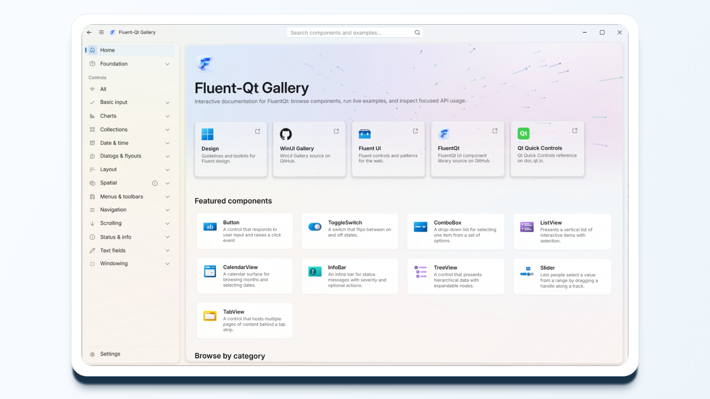

<p align="center">
  <a href="README.md">English</a> | <a href="README.zh-CN.md">简体中文</a> | <a href="README.zh-TW.md">繁體中文</a> | 日本語 | <a href="README.ko.md">한국어</a> | <a href="README.de.md">Deutsch</a> | <a href="README.ru.md">Русский</a> | <a href="README.es.md">Español</a> | <a href="README.fr.md">Français</a>
</p>

<p align="center">
  
</p>

<h1 align="center">Fluent-Qt</h1>

<p align="center">
  Qt Widgets 向けのクロスプラットフォーム Fluent スタイル C++ UI コンポーネントライブラリ。
</p>

<p align="center">
  <a href="https://github.com/calvinhxx/Fluent-Qt/actions/workflows/ci.yml"></a>
  <a href="https://github.com/calvinhxx/Fluent-Qt/stargazers"></a>
  <a href="LICENSE"></a>
  
  
  
  
  <a href="https://pypi.org/project/FluentQt/"></a>
</p>

<p align="center">
  <a href="https://calvinhxx.github.io/Fluent-Qt/ja/#top"></a>
</p>

<p align="center">
  <strong><a href="https://calvinhxx.github.io/Fluent-Qt/ja/#gallery">C++ Web Gallery をライブ体験</a></strong>
  ·
  <strong><a href="https://calvinhxx.github.io/Fluent-Qt/ja/api/checkbox/?playground=1">プロパティプレビュー</a></strong>
  ·
  <a href="https://calvinhxx.github.io/Fluent-Qt/ja/api/">ドキュメント・API</a>
  ·
  <a href="https://calvinhxx.github.io/Fluent-Qt/ja/#top">プロジェクト公式サイト</a>
  ·
  <a href="https://github.com/calvinhxx/Fluent-Qt/discussions">質問・コミュニティ</a>
  ·
  <a href="https://calvinhxx.github.io/Fluent-Qt/ja/#support">プロジェクトを支援</a>
</p>

Fluent-Qt（FluentQt）は Qt Widgets 向けの Fluent スタイル UI コントロール群を提供し、入力、ナビゲーション、コレクション、データグリッド、[チャート](docs/architecture/charts.md)、ダイアログ、ポップアップ、ウィンドウをカバーします。C++17 で書かれており、CMake 経由で既存の Qt プロジェクトに組み込めるほか、オプションで PySide6 バインディングも利用できます。

Windows、macOS、Linux、WebAssembly 上で動作し、ライト、ダーク、ハイコントラストのテーマと設定可能なアニメーションモードを備えています。オプションモジュールを有効にすると、パーティクル背景（[Particles](docs/architecture/particles.md)）、3D パース表示（[Spatial](docs/architecture/spatial-view.md)）、埋め込み QML ページ（[QmlBridge](docs/architecture/qml-bridge.md)）を追加できます。

## 🧩 ライブラリモジュール

| モジュール | CMake ターゲット | 用途 |
|---|---|---|
| Core | `FluentQt::FluentQt` | すべての 2D コントロール、テーマ、タイポグラフィ、レイアウトヘルパー、チャート。通常の 2D アプリはこのターゲットのみリンクします。 |
| [Plugins](docs/architecture/plugins.md) | `FluentQt::Plugins` | プロセス内プラグイン登録、依存関係順の起動・停止、クリーンアップ。 |
| [Particles](docs/architecture/particles.md) | `FluentQt::Particles` | CPU 描画によるアニメーション付きパーティクル背景（`ParticleBackdrop`、OpenGL 不要）と `ParticlesSession` による一時停止・再開。 |
| [Spatial](docs/architecture/spatial-view.md) | `FluentQt::Spatial` | 既存の `QWidget` レイアウトに遠近感を追加。セッション起動やビュー作成に失敗した場合はアプリ側が [2D レイアウト](examples/hello_world/README.md) を提供します。 |
| [QmlBridge](docs/architecture/qml-bridge.md) | `FluentQt::QmlBridge` | アプリのモデルと Fluent テーマを共有しながら Widgets 内に QML ページを埋め込む `QmlView`。 |

C++ アプリはこれらのターゲットを直接リンクし、Python アプリは対応する PySide6 モジュールを使用します。WebAssembly は同じ C++ コードをブラウザ向けにコンパイルします。拡張サンプルは Gallery の **Plugins → Particles**、**Plugins → Spatial**（**Settings → 3D Gallery** を有効化）、**Plugins → QmlBridge → QmlView** から試せるほか、[最小 QML サンプル](examples/qml_bridge/)も参照できます。

## 🖼 Gallery とオンラインドキュメント

Gallery を使ってコントロール一覧を閲覧し、インタラクションを試し、C++ と Python のサンプルコードを確認できます。

| 試す方法 | エントリーポイント |
|---|---|
| ブラウザ（WebAssembly Gallery） | [ライブ Gallery](https://calvinhxx.github.io/Fluent-Qt/gallery/) · [プロジェクト公式サイト](https://calvinhxx.github.io/Fluent-Qt/ja/#gallery) |
| オンラインドキュメント＆プロパティプレビュー | [ドキュメント・API](https://calvinhxx.github.io/Fluent-Qt/ja/api/) · [プロパティプレビューを試す](https://calvinhxx.github.io/Fluent-Qt/ja/api/checkbox/?playground=1) |
| Windows、macOS、Linux | [Gallery パッケージをダウンロード](https://github.com/calvinhxx/Fluent-Qt/releases/latest) |

### コンポーネントドキュメントとプロパティプレビュー

[オンラインドキュメント](https://calvinhxx.github.io/Fluent-Qt/ja/api/)では、基礎ガイド、コンポーネントの API リファレンス、[リリースノート](https://calvinhxx.github.io/Fluent-Qt/ja/api/releases/)を日本語で読めます。各コンポーネントページの **プロパティプレビュー** を開くと、実際の Qt プロパティを調整して生成された C++ または PySide6 コードをコピーできます。

<p>
  <a href="https://calvinhxx.github.io/Fluent-Qt/ja/api/checkbox/?playground=1">
    
  </a>
</p>

クイック起動：[Button](https://calvinhxx.github.io/Fluent-Qt/ja/api/button/?playground=1) · [CheckBox](https://calvinhxx.github.io/Fluent-Qt/ja/api/checkbox/?playground=1) · [ComboBox](https://calvinhxx.github.io/Fluent-Qt/ja/api/combobox/?playground=1) · [DataGrid](https://calvinhxx.github.io/Fluent-Qt/ja/api/data-grid/?playground=1) · [LineChart](https://calvinhxx.github.io/Fluent-Qt/ja/api/line-chart/?playground=1) · [ParticleBackdrop](https://calvinhxx.github.io/Fluent-Qt/ja/api/particle-backdrop/?playground=1) · [SpatialView](https://calvinhxx.github.io/Fluent-Qt/ja/api/spatial-view/?playground=1) · [QmlView](https://calvinhxx.github.io/Fluent-Qt/ja/api/qml-view/?playground=1)

### Python Gallery

[PyPI](https://pypi.org/project/FluentQt-Gallery/) から Python 版 Gallery をインストールできます（対応バージョンの `FluentQt` も自動的にインストールされます）。

```bash
python -m pip install FluentQt-Gallery
python -m fluentqt_gallery
```

## 🤖 AI で UI を構築

Codex、Claude Code、Cursor で [`build-fluentqt-gui`](.agents/skills/build-fluentqt-gui/SKILL.md) スキルを使うと、デスクトップアプリの新規作成、既存プロジェクトへの GUI 追加、UI の改善を行えます。[実例を見る](https://calvinhxx.github.io/Fluent-Qt/ja/#ai-build) · [導入と使い方](docs/ai/README.md)

Gallery サンプルを調整する際は、Live Scene で保存済みの変更をプレビューしてから、コンパイル済み C++ サンプルで最終確認してください。[仕組み](docs/development/gallery-preview-workflow.md)

## 🚀 クイックスタート

C++ 統合には C++17、CMake 3.16+、Qt Widgets 5.15+ または 6.2+ が必要です。新規プロジェクトでは `FetchContent` の利用を推奨します。

### C++ セットアップ

#### `FetchContent` による統合

```cmake
cmake_minimum_required(VERSION 3.16)
project(my_app LANGUAGES CXX)

set(CMAKE_CXX_STANDARD 17)
set(CMAKE_CXX_STANDARD_REQUIRED ON)

include(FetchContent)
FetchContent_Declare(
    fluentqt
    GIT_REPOSITORY https://github.com/calvinhxx/Fluent-Qt.git
    GIT_TAG v1.12.1
    GIT_SHALLOW TRUE
)
FetchContent_MakeAvailable(fluentqt)

add_executable(my_app main.cpp)
target_link_libraries(my_app PRIVATE FluentQt::FluentQt)
```

#### ソース統合

アプリケーションターゲットを定義した後、Fluent-Qt のソースディレクトリを追加してエクスポートされたターゲットをリンクします。

```cmake
add_subdirectory(Fluent-Qt)
target_link_libraries(my_app PRIVATE FluentQt::FluentQt)
```

#### インストール済みライブラリ統合

開発用ヘッダーと CMake パッケージファイルを含むインストール済み FluentQt を使用します。詳細は[ライブラリのビルドとインストールガイド](docs/development/build-workflow.md#install-the-library-or-create-a-source-package)を参照してください。

```cmake
find_package(FluentQt CONFIG REQUIRED)
target_link_libraries(my_app PRIVATE FluentQt::FluentQt)
```

FluentQt がシステム検索パス外にある場合は、`-DCMAKE_PREFIX_PATH=/path/to/fluentqt` を指定して設定してください。

### C++ 最小サンプル

`main.cpp`:

```cpp
#include <FluentQt/FluentQt.h>

#include <QApplication>
#include <QVBoxLayout>
#include <QWidget>

int main(int argc, char* argv[])
{
    fluent::prepareHighDpiApplication();
    QApplication app(argc, argv);
    fluent::initializeResources();
    app.setFont(Typography::fontStyle(Typography::FontRole::Body).toQFont());

    fluent::windowing::Window window;
    window.setWindowTitle(QStringLiteral("FluentQt Hello World"));
    window.resize(480, 320);

    auto* content = new QWidget;
    auto* layout = new QVBoxLayout(content);
    layout->setContentsMargins(32, 32, 32, 32);

    auto* button = new fluent::basicinput::Button(
        QStringLiteral("Hello from FluentQt"), content);
    button->setFluentStyle(fluent::basicinput::Button::Accent);
    layout->addStretch();
    layout->addWidget(button, 0, Qt::AlignCenter);
    layout->addStretch();

    window.setContentWidget(content);
    window.show();
    return app.exec();
}
```

プロジェクト全体は [`examples/hello_world`](examples/hello_world/) を参照するか、IDE から `fluentqt_hello_world` ターゲットを直接実行してください。

### Python (PySide6)

PyPI から PySide6 バインディング（Shiboken6 経由）をインストールします。

```bash
python -m pip install FluentQt
```

サンプル、互換性情報、ソースビルド手順は [Python ガイド](bindings/pyside6/README.md)を参照してください。

## 🛠 ビルド

### 依存関係

| 対象 | 依存関係 |
|---|---|
| FluentQt C++ ライブラリ | C++17、CMake 3.16+、Qt Widgets 5.15+ または 6.2+ |
| C++ Gallery | FluentQt、Qt Network、spdlog/fmt |
| C++ WebAssembly | Qt 6.9.3 `wasm_singlethread`、Emscripten 3.1.70 |
| テスト | FluentQt、Qt Test/Network、GTest、spdlog/fmt |
| オプション PySide6 バインディング | Qt/PySide6/Shiboken6 6.2.4+；ソースビルドには Python 3.10+ |

### ライブラリ

```bash
cmake -S . -B build/fluentqt \
  -DCMAKE_BUILD_TYPE=Release \
  -DCMAKE_PREFIX_PATH=/path/to/Qt
python3 tools/dev/fluent_qt_build.py build/fluentqt --config Release --target FluentQt
cmake --install build/fluentqt --config Release \
  --component Development --prefix /path/to/install
```

ビルドスクリプトは利用可能な CPU とメモリに応じて並列度を自動選択します。設定方法は[ビルドワークフロー](docs/development/build-workflow.md)を参照してください。

### オプション拡張モジュール

FluentQt の設定時に Plugins モジュールまたは特定の拡張機能を有効化し、アプリで対応する CMake ターゲットをリンクします。

| 拡張範囲 | ビルドオプション | CMake ターゲット | 統合例 |
|---|---|---|---|
| Plugins コア | `-DFLUENT_QT_BUILD_PLUGINS=ON` | `FluentQt::Plugins` | [最小プラグイン例](docs/architecture/plugins.md#minimal-extension-example) |
| Plugins → Particles | `-DFLUENT_QT_BUILD_PARTICLES=ON` | `FluentQt::Particles` | [Particles 統合](docs/architecture/particles.md) |
| Plugins → Spatial | `-DFLUENT_QT_BUILD_SPATIAL=ON` | `FluentQt::Spatial`（Plugins を自動包含） | [Spatial Hello World](examples/hello_world/README.md) |
| Plugins → QmlBridge | `-DFLUENT_QT_BUILD_QML_BRIDGE=ON` | `FluentQt::QmlBridge`（Plugins を自動包含） | [QML ホスト例](examples/qml_bridge/) |

ソースからビルドする場合は、`add_subdirectory()` または `FetchContent_MakeAvailable()` の前にこれらのオプションを設定してください。対応する Python ビルドでは `fluentqt.plugins`、`fluentqt.spatial`、`fluentqt.qmlbridge` が公開され、WebAssembly では共有 C++ 実装がコンパイルされます。

### Gallery をローカルでビルド

リポジトリのプリセットには CMake 3.25+ と `VCPKG_ROOT` が必要です。[初回セットアップ](docs/development/build-workflow.md#first-use-setup)の手順で Qt kit を構成してください。

現在のホストで利用可能なプリセットを一覧表示します。

```bash
cmake --list-presets
```

Apple Silicon では `vcpkg-osx` を使用します。

```bash
cmake --preset vcpkg-osx
python3 tools/dev/fluent_qt_build.py \
  --preset vcpkg-osx \
  --target fluent_qt_gallery
```

他のプラットフォームでは対応するプリセットを使用してください。

| プラットフォーム | プリセット |
|---|---|
| Apple Silicon Mac | `vcpkg-osx` |
| Intel Mac または Rosetta | `vcpkg-osx-x64` |
| Linux x64 | `vcpkg-linux` |
| Linux ARM64 | `vcpkg-linux-arm64` |
| Windows x64 | `vcpkg-windows` |
| Windows ARM64 | `vcpkg-windows-arm64` |

パッケージングには対応する `-release` プリセットを使用し、[パッケージングワークフロー](docs/development/packaging-workflow.md)の検証手順に従ってください。

### WebAssembly

ブラウザ向けツールチェーン、ローカルビルド、検証、Pages デプロイについては [WebAssembly ワークフロー](docs/development/webassembly-workflow.md)を参照してください。

### ソースパッケージ

オフラインまたはソース統合向けの軽量ソースパッケージを作成します。

```bash
python3 tools/dev/fluent_qt_build.py build/fluentqt --target fluent_qt_source_package
```

## 📚 ドキュメント

[ドキュメントマップ](docs/README.md)から始めるか、目的に合わせて直接移動してください。

| 目的 | エントリーポイント |
|---|---|
| コントロールと API の閲覧 | [ドキュメント・API](https://calvinhxx.github.io/Fluent-Qt/ja/api/) · [WebAssembly Gallery](https://calvinhxx.github.io/Fluent-Qt/ja/#gallery) |
| アプリの構築 | [AI 支援開発](docs/ai/README.md) · [オンボーディングツール](tools/onboarding/README.md) |
| FluentQt への貢献 | [開発ガイド](docs/development/README.md) · [アーキテクチャ](docs/architecture/README.md) · [Fluent デザイン](docs/design-languages/README.md) |
| パッケージングとリリース | [パッケージング](docs/development/packaging-workflow.md) · [リリース運用](docs/development/release-governance.md) · [リリースノート](docs/releases/README.md) |
| 質問・バグ報告 | [コミュニティ](docs/community/README.md) · [サポート](SUPPORT.md) · [セキュリティ](SECURITY.md) |

Pull Request を作成する前に、[貢献ガイド](CONTRIBUTING.md)と[行動規範](CODE_OF_CONDUCT.md)をお読みください。

## 🔗 リファレンス

| リソース | 用途 |
|---|---|
| [Windows UI Kit (Community)](https://www.figma.com/design/qpecbg7hOfos9DcHWeKlfw/Windows-UI-kit--Community-?node-id=2434-129659) | Fluent / Windows ビジュアルリファレンス |
| [WinUI Gallery](https://github.com/microsoft/WinUI-Gallery) | コントロール挙動・サンプルページのリファレンス |

## ライセンス

Fluent-Qt 自身のソースコードは [MIT License](LICENSE) の下で公開されています。同梱アセットおよびパッケージ化されたランタイム依存関係は各自のアップストリームライセンスを保持します。バージョン、入手元、ソースコードの入手可能性、ライセンス詳細は [THIRD_PARTY_NOTICES.md](THIRD_PARTY_NOTICES.md) を、商標およびサードパーティ製デザインリファレンスについては [TRADEMARKS.md](TRADEMARKS.md) をご覧ください。
