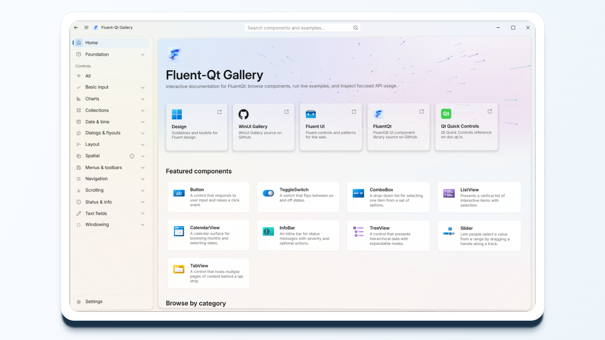

<p align="center">
  <a href="README.md">English</a> | <a href="README.zh-CN.md">简体中文</a> | <a href="README.zh-TW.md">繁體中文</a> | <a href="README.ja.md">日本語</a> | 한국어 | <a href="README.de.md">Deutsch</a> | <a href="README.ru.md">Русский</a> | <a href="README.es.md">Español</a> | <a href="README.fr.md">Français</a>
</p>

<p align="center">
  
</p>

<h1 align="center">Fluent-Qt</h1>

<p align="center">
  Qt Widgets를 위한 크로스 플랫폼 Fluent 스타일 C++ UI 컴포넌트 라이브러리.
</p>

<p align="center">
  <a href="https://github.com/calvinhxx/Fluent-Qt/actions/workflows/ci.yml"></a>
  <a href="https://github.com/calvinhxx/Fluent-Qt/stargazers"></a>
  <a href="LICENSE"></a>
  
  
  
  
  <a href="https://pypi.org/project/FluentQt/"></a>
</p>

<p align="center">
  <a href="https://calvinhxx.github.io/Fluent-Qt/ko/#top"></a>
</p>

<p align="center">
  <strong><a href="https://calvinhxx.github.io/Fluent-Qt/ko/#gallery">실시간 C++ Web Gallery 체험하기</a></strong>
  ·
  <strong><a href="https://calvinhxx.github.io/Fluent-Qt/ko/api/checkbox/?playground=1">속성 미리 보기</a></strong>
  ·
  <a href="https://calvinhxx.github.io/Fluent-Qt/ko/api/">문서 및 API</a>
  ·
  <a href="https://calvinhxx.github.io/Fluent-Qt/ko/#top">프로젝트 웹사이트</a>
  ·
  <a href="https://github.com/calvinhxx/Fluent-Qt/discussions">질문 및 커뮤니티</a>
  ·
  <a href="https://calvinhxx.github.io/Fluent-Qt/ko/#support">프로젝트 후원</a>
</p>

Fluent-Qt(FluentQt)는 입력, 내비게이션, 컬렉션, 데이터 그리드, [차트](docs/architecture/charts.md), 대화 상자, 팝업, 창을 포함한 Qt Widgets용 Fluent 스타일 컨트롤을 제공합니다. C++17로 작성되어 CMake를 통해 기존 Qt 프로젝트에 쉽게 통합할 수 있으며 선택적 PySide6 바인딩도 지원합니다.

애플리케이션은 라이트, 다크, 고대비 테마와 설정 가능한 애니메이션 모드와 함께 Windows, macOS, Linux 및 WebAssembly에서 실행됩니다. 선택적 모듈을 활성화하면 파티클 배경([Particles](docs/architecture/particles.md)), 3D 원근 뷰([Spatial](docs/architecture/spatial-view.md)), 임베디드 QML 페이지([QmlBridge](docs/architecture/qml-bridge.md))를 추가할 수 있습니다.

## 🧩 라이브러리 모듈

| 모듈 | CMake 타깃 | 설명 |
|---|---|---|
| Core | `FluentQt::FluentQt` | 모든 2D 컨트롤, 테마, 타이포그래피, 레이아웃 헬퍼 및 차트. 일반 2D 앱은 이 타깃만 링크하면 됩니다. |
| [Plugins](docs/architecture/plugins.md) | `FluentQt::Plugins` | 인프로세스 플러그인 등록, 의존성 정렬, 활성화 및 정리. |
| [Particles](docs/architecture/particles.md) | `FluentQt::Particles` | CPU 렌더링 애니메이션 파티클 배경(`ParticleBackdrop`, OpenGL 불필요) 및 `ParticlesSession` 일시 중지/재개. |
| [Spatial](docs/architecture/spatial-view.md) | `FluentQt::Spatial` | 기존 `QWidget` 레이아웃에 원근감을 더합니다. 세션 활성화나 뷰 생성에 실패하면 앱이 [2D 레이아웃](examples/hello_world/README.md)을 제공합니다. |
| [QmlBridge](docs/architecture/qml-bridge.md) | `FluentQt::QmlBridge` | 앱 모델과 Fluent 테마를 공유하면서 Widgets 창 안에 QML 페이지를 임베딩하는 `QmlView`. |

C++ 앱은 이 타깃들을 직접 링크하고, Python 앱은 대응하는 PySide6 모듈을 사용하며, WebAssembly는 동일한 C++ 코드를 브라우저용으로 컴파일합니다. Gallery의 **Plugins → Particles**, **Plugins → Spatial**(**Settings → 3D Gallery** 활성화), **Plugins → QmlBridge → QmlView**에서 확장 예제를 체험하거나 [최소 QML 예제](examples/qml_bridge/)를 참고하세요.

## 🖼 Gallery 및 온라인 문서

Gallery를 통해 컨트롤을 둘러보고 인터랙션을 시험하며 C++ 및 Python 예제 코드를 확인할 수 있습니다.

| 실행 환경 | 바로가기 |
|---|---|
| 브라우저 (WebAssembly Gallery) | [라이브 Gallery](https://calvinhxx.github.io/Fluent-Qt/gallery/) · [프로젝트 웹사이트](https://calvinhxx.github.io/Fluent-Qt/ko/#gallery) |
| 온라인 문서 및 속성 미리 보기 | [가이드 및 API 문서](https://calvinhxx.github.io/Fluent-Qt/ko/api/) · [속성 미리 보기 체험](https://calvinhxx.github.io/Fluent-Qt/ko/api/checkbox/?playground=1) |
| Windows, macOS, Linux | [Gallery 패키지 다운로드](https://github.com/calvinhxx/Fluent-Qt/releases/latest) |

### 컴포넌트 문서 및 속성 미리 보기

[온라인 문서](https://calvinhxx.github.io/Fluent-Qt/ko/api/)에서 기초 가이드, 컴포넌트 API와 [릴리스 노트](https://calvinhxx.github.io/Fluent-Qt/ko/api/releases/)를 한국어로 볼 수 있습니다. 각 컴포넌트 페이지에서 **속성 미리 보기**를 열면 실제 Qt 속성을 조절하고 생성된 C++ 또는 PySide6 코드를 복사할 수 있습니다:

<p>
  <a href="https://calvinhxx.github.io/Fluent-Qt/ko/api/checkbox/?playground=1">
    
  </a>
</p>

빠른 체험: [Button](https://calvinhxx.github.io/Fluent-Qt/ko/api/button/?playground=1) · [CheckBox](https://calvinhxx.github.io/Fluent-Qt/ko/api/checkbox/?playground=1) · [ComboBox](https://calvinhxx.github.io/Fluent-Qt/ko/api/combobox/?playground=1) · [DataGrid](https://calvinhxx.github.io/Fluent-Qt/ko/api/data-grid/?playground=1) · [LineChart](https://calvinhxx.github.io/Fluent-Qt/ko/api/line-chart/?playground=1) · [ParticleBackdrop](https://calvinhxx.github.io/Fluent-Qt/ko/api/particle-backdrop/?playground=1) · [SpatialView](https://calvinhxx.github.io/Fluent-Qt/ko/api/spatial-view/?playground=1) · [QmlView](https://calvinhxx.github.io/Fluent-Qt/ko/api/qml-view/?playground=1)

### Python Gallery

[PyPI](https://pypi.org/project/FluentQt-Gallery/)에서 Python Gallery를 설치할 수 있습니다(호환되는 `FluentQt` 버전이 함께 설치됩니다):

```bash
python -m pip install FluentQt-Gallery
python -m fluentqt_gallery
```

## 🤖 AI로 GUI 구축하기

Codex, Claude Code 또는 Cursor에서 [`build-fluentqt-gui`](.agents/skills/build-fluentqt-gui/SKILL.md) 스킬을 사용해 데스크톱 앱을 만들거나, 기존 프로젝트에 GUI를 추가하거나, 인터페이스를 다듬을 수 있습니다. [예제 보기](https://calvinhxx.github.io/Fluent-Qt/ko/#ai-build) · [설치 및 사용법](docs/ai/README.md)

Gallery 예제를 다듬을 때는 저장된 변경 사항을 Live Scene에서 먼저 미리 본 뒤 컴파일된 C++ 예제로 확인하세요. [작동 원리](docs/development/gallery-preview-workflow.md)

## 🚀 빠른 시작

C++ 통합에는 C++17, CMake 3.16+, Qt Widgets 5.15+ 또는 6.2+가 필요합니다. 새 프로젝트에는 `FetchContent` 사용을 권장합니다.

### C++ 설정

#### `FetchContent` 통합

```cmake
cmake_minimum_required(VERSION 3.16)
project(my_app LANGUAGES CXX)

set(CMAKE_CXX_STANDARD 17)
set(CMAKE_CXX_STANDARD_REQUIRED ON)

include(FetchContent)
FetchContent_Declare(
    fluentqt
    GIT_REPOSITORY https://github.com/calvinhxx/Fluent-Qt.git
    GIT_TAG v1.12.1
    GIT_SHALLOW TRUE
)
FetchContent_MakeAvailable(fluentqt)

add_executable(my_app main.cpp)
target_link_libraries(my_app PRIVATE FluentQt::FluentQt)
```

#### 소스 통합

애플리케이션 타깃을 정의한 뒤 Fluent-Qt 소스 디렉터리를 추가하고 내보낸 타깃을 링크하세요:

```cmake
add_subdirectory(Fluent-Qt)
target_link_libraries(my_app PRIVATE FluentQt::FluentQt)
```

#### 설치된 라이브러리 통합

개발용 헤더와 CMake 패키지 파일이 포함된 FluentQt 설치본을 사용하세요. 자세한 내용은 [라이브러리 빌드 및 설치 가이드](docs/development/build-workflow.md#install-the-library-or-create-a-source-package)를 참고하세요.

```cmake
find_package(FluentQt CONFIG REQUIRED)
target_link_libraries(my_app PRIVATE FluentQt::FluentQt)
```

FluentQt가 시스템 검색 경로 밖에 있는 경우 `-DCMAKE_PREFIX_PATH=/path/to/fluentqt`로 구성하세요.

### C++ 최소 예제

`main.cpp`:

```cpp
#include <FluentQt/FluentQt.h>

#include <QApplication>
#include <QVBoxLayout>
#include <QWidget>

int main(int argc, char* argv[])
{
    fluent::prepareHighDpiApplication();
    QApplication app(argc, argv);
    fluent::initializeResources();
    app.setFont(Typography::fontStyle(Typography::FontRole::Body).toQFont());

    fluent::windowing::Window window;
    window.setWindowTitle(QStringLiteral("FluentQt Hello World"));
    window.resize(480, 320);

    auto* content = new QWidget;
    auto* layout = new QVBoxLayout(content);
    layout->setContentsMargins(32, 32, 32, 32);

    auto* button = new fluent::basicinput::Button(
        QStringLiteral("Hello from FluentQt"), content);
    button->setFluentStyle(fluent::basicinput::Button::Accent);
    layout->addStretch();
    layout->addWidget(button, 0, Qt::AlignCenter);
    layout->addStretch();

    window.setContentWidget(content);
    window.show();
    return app.exec();
}
```

전체 프로젝트는 [`examples/hello_world`](examples/hello_world/)에서 확인하거나 IDE에서 `fluentqt_hello_world` 타깃을 바로 실행해 보세요.

### Python (PySide6)

PyPI에서 PySide6 바인딩(Shiboken6 기반)을 설치합니다:

```bash
python -m pip install FluentQt
```

예제, 호환성 및 소스 빌드 안내는 [Python 가이드](bindings/pyside6/README.md)를 확인하세요.

### Qt Designer

Qt Creator(C++)와 pyside6-designer(Python)에서 FluentQt 위젯과 폼 템플릿을 드래그 앤 드롭하고 `.ui` 파일을 공유할 수 있습니다. 설정 및 사용법은 [Qt Designer 가이드](tools/designer/README.md)를 확인하세요.

## 🛠 빌드

### 의존성

| 범위 | 의존성 |
|---|---|
| FluentQt C++ 라이브러리 | C++17, CMake 3.16+, Qt Widgets 5.15+ 또는 6.2+ |
| C++ Gallery | FluentQt, Qt Network, spdlog/fmt |
| C++ WebAssembly | Qt 6.9.3 `wasm_singlethread`, Emscripten 3.1.70 |
| 테스트 | FluentQt, Qt Test/Network, GTest, spdlog/fmt |
| 선택적 PySide6 바인딩 | Qt/PySide6/Shiboken6 6.2.4+; 소스 빌드는 Python 3.10+ |

### 라이브러리

```bash
cmake -S . -B build/fluentqt \
  -DCMAKE_BUILD_TYPE=Release \
  -DCMAKE_PREFIX_PATH=/path/to/Qt
python3 tools/dev/fluent_qt_build.py build/fluentqt --config Release --target FluentQt
cmake --install build/fluentqt --config Release \
  --component Development --prefix /path/to/install
```

빌드 스크립트는 사용 가능한 CPU와 메모리에 따라 병렬 작업 수를 자동 선택합니다. 구성 방법은 [빌드 워크플로](docs/development/build-workflow.md)를 참조하세요.

### 선택적 확장 모듈

FluentQt 구성 시 Plugins 모듈이나 특정 확장을 활성화한 뒤 앱에서 해당 CMake 타깃을 링크하세요:

| 확장 범위 | 빌드 옵션 | CMake 타깃 | 통합 예제 |
|---|---|---|---|
| Plugins 코어 | `-DFLUENT_QT_BUILD_PLUGINS=ON` | `FluentQt::Plugins` | [최소 플러그인 예제](docs/architecture/plugins.md#minimal-extension-example) |
| Plugins → Particles | `-DFLUENT_QT_BUILD_PARTICLES=ON` | `FluentQt::Particles` | [Particles 통합](docs/architecture/particles.md) |
| Plugins → Spatial | `-DFLUENT_QT_BUILD_SPATIAL=ON` | `FluentQt::Spatial` (Plugins 자동 포함) | [Spatial Hello World](examples/hello_world/README.md) |
| Plugins → QmlBridge | `-DFLUENT_QT_BUILD_QML_BRIDGE=ON` | `FluentQt::QmlBridge` (Plugins 자동 포함) | [QML 호스트 예제](examples/qml_bridge/) |

소스에서 빌드할 때는 `add_subdirectory()` 또는 `FetchContent_MakeAvailable()` 전에 이 옵션들을 설정하세요. 대응하는 Python 빌드는 `fluentqt.plugins`, `fluentqt.spatial`, `fluentqt.qmlbridge` 모듈을 노출하며 WebAssembly는 공유된 C++ 구현을 컴파일합니다.

### 로컬에서 Gallery 빌드

저장소 프리셋은 CMake 3.25+와 `VCPKG_ROOT`가 필요합니다. [초기 설정](docs/development/build-workflow.md#first-use-setup)을 참고해 Qt kit를 구성하세요.

현재 호스트에서 사용 가능한 프리셋 목록 확인:

```bash
cmake --list-presets
```

Apple Silicon에서는 `vcpkg-osx`를 사용합니다:

```bash
cmake --preset vcpkg-osx
python3 tools/dev/fluent_qt_build.py \
  --preset vcpkg-osx \
  --target fluent_qt_gallery
```

다른 플랫폼에서는 대응하는 프리셋을 사용하세요:

| 플랫폼 | 프리셋 |
|---|---|
| Apple Silicon Mac | `vcpkg-osx` |
| Intel Mac 또는 Rosetta | `vcpkg-osx-x64` |
| Linux x64 | `vcpkg-linux` |
| Linux ARM64 | `vcpkg-linux-arm64` |
| Windows x64 | `vcpkg-windows` |
| Windows ARM64 | `vcpkg-windows-arm64` |

패키징 시에는 대응하는 `-release` 프리셋을 사용하고 [패키징 워크플로](docs/development/packaging-workflow.md)의 검증 단계를 따르세요.

### WebAssembly

브라우저 툴체인, 로컬 빌드, 검증 및 Pages 배포 안내는 [WebAssembly 워크플로](docs/development/webassembly-workflow.md)를 확인하세요.

### 소스 패키지

오프라인 또는 소스 통합을 위한 축소된 라이브러리 소스 패키지를 생성합니다:

```bash
python3 tools/dev/fluent_qt_build.py build/fluentqt --target fluent_qt_source_package
```

## 📚 문서

[문서 지도](docs/README.md)에서 시작하거나 필요한 항목으로 바로 이동하세요:

| 목표 | 바로가기 |
|---|---|
| 컨트롤 및 API 탐색 | [컴포넌트 문서 및 API](https://calvinhxx.github.io/Fluent-Qt/ko/api/) · [WebAssembly Gallery](https://calvinhxx.github.io/Fluent-Qt/ko/#gallery) |
| 앱 구축 | [AI 지원 개발](docs/ai/README.md) · [온보딩 도구](tools/onboarding/README.md) · [Qt Designer](tools/designer/README.md) |
| FluentQt 기여 | [개발 가이드](docs/development/README.md) · [아키텍처](docs/architecture/README.md) · [Fluent 디자인](docs/design-languages/README.md) |
| 패키징 및 릴리스 | [패키징](docs/development/packaging-workflow.md) · [릴리스 거버넌스](docs/development/release-governance.md) · [릴리스 노트](docs/releases/README.md) |
| 도움 받기 및 버그 제보 | [커뮤니티](docs/community/README.md) · [지원](SUPPORT.md) · [보안](SECURITY.md) |

Pull Request를 열기 전에 [기여 가이드](CONTRIBUTING.md)와 [행동 강령](CODE_OF_CONDUCT.md)을 읽어 주세요.

## 🔗 참고 자료

| 출처 | 용도 |
|---|---|
| [Windows UI Kit (Community)](https://www.figma.com/design/qpecbg7hOfos9DcHWeKlfw/Windows-UI-kit--Community-?node-id=2434-129659) | Fluent / Windows 시각적 참고 자료 |
| [WinUI Gallery](https://github.com/microsoft/WinUI-Gallery) | 컨트롤 동작 및 예제 페이지 참고 |

## 라이선스

Fluent-Qt 자체 소스 코드는 [MIT License](LICENSE)로 배포됩니다. 번들된 애셋 및 패키징된 런타임 종속성은 각 업스트림 라이선스를 따르며, 버전·출처·소스 제공 여부 및 라이선스 세부 정보는 [THIRD_PARTY_NOTICES.md](THIRD_PARTY_NOTICES.md)에 정리되어 있습니다. 상표 및 서드파티 디자인 참조에 대한 안내는 [TRADEMARKS.md](TRADEMARKS.md)를 확인하세요.
