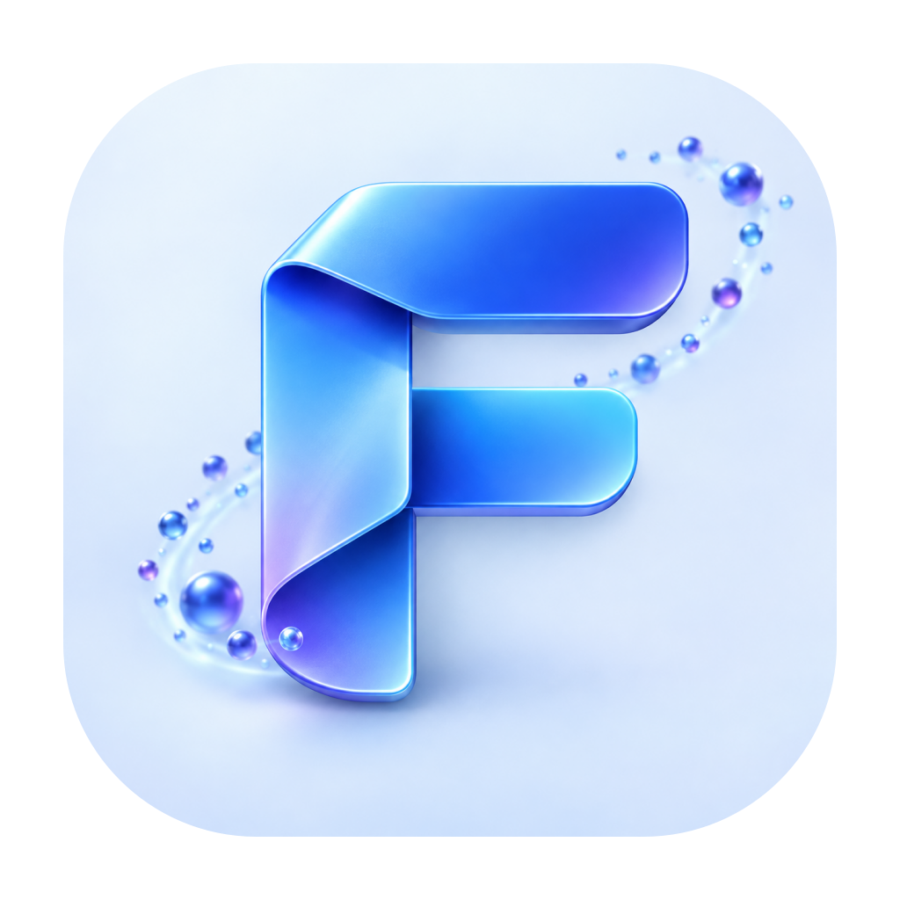

<p align="center">
  English | <a href="README.zh-CN.md">简体中文</a> | <a href="README.zh-TW.md">繁體中文</a> | <a href="README.ja.md">日本語</a> | <a href="README.ko.md">한국어</a> | <a href="README.de.md">Deutsch</a> | <a href="README.ru.md">Русский</a> | <a href="README.es.md">Español</a> | <a href="README.fr.md">Français</a>
</p>

<p align="center">
  
</p>

<h1 align="center">Fluent-Qt</h1>

<p align="center">
  MIT-licensed native Fluent UI component library for Qt Widgets — one C++17 implementation for C++, PySide6, and WebAssembly.
</p>

<p align="center">
  <a href="https://github.com/calvinhxx/Fluent-Qt/actions/workflows/ci.yml"></a>
  <a href="https://github.com/calvinhxx/Fluent-Qt/stargazers"></a>
  <a href="LICENSE"></a>
  
  
  
  
  <a href="bindings/pyside6/README.md"></a>
  <a href="https://pypi.org/project/FluentQt/"></a>
</p>

<p align="center">
  <a href="https://calvinhxx.github.io/Fluent-Qt/#gallery"></a>
</p>

<p align="center">
  <strong><a href="https://calvinhxx.github.io/Fluent-Qt/#gallery">Try the live C++ Web Gallery</a></strong>
  ·
  <strong><a href="https://calvinhxx.github.io/Fluent-Qt/studio/?lang=en">Page Studio</a></strong>
  ·
  <strong><a href="https://calvinhxx.github.io/Fluent-Qt/api/checkbox/?playground=1">Property preview</a></strong>
  ·
  <a href="https://calvinhxx.github.io/Fluent-Qt/api/">Docs &amp; API</a>
  ·
  <a href="https://calvinhxx.github.io/Fluent-Qt/#top">Project website</a>
  ·
  <a href="https://github.com/calvinhxx/Fluent-Qt/discussions">Questions &amp; community</a>
  ·
  <a href="https://calvinhxx.github.io/Fluent-Qt/#support">Support the project</a>
</p>

Fluent-Qt (FluentQt) brings Fluent UI to Qt Widgets across C++17, PySide6, and WebAssembly from one native codebase:

- **MIT-licensed for commercial and open-source apps** — the C++17 library, PySide6 bindings, Qt Designer plugin, and application starters all use the MIT license.
- **One native C++17 implementation** — 99 Gallery entries including `DataGrid`, [charts](docs/architecture/charts.md), navigation, overlays, dialogs, and windows run the same C++17 widgets in C++ (`Qt 5.15+` / `6.2+`), `PySide6`, and `WebAssembly`, rather than stylesheet-only skins.
- **Visual design and shared `.ui` forms** — arrange controls in browser **Page Studio** (exporting C++, PySide6, or `.ui`) or design directly in **Qt Creator** and `pyside6-designer` (95 Widget Box entries and 4 form templates).
- **Application starters and AI GUI skill** — scaffold layered `monitor`, `workbench`, and `existing-qt` apps via `python3 tools/onboarding/fluentqt`, or build interfaces with [`build-fluentqt-gui`](.agents/skills/build-fluentqt-gui/SKILL.md).
- **Opt-in extension modules** — core apps depend only on `Qt Widgets`; enable CPU particle backgrounds ([Particles](docs/architecture/particles.md)), 3D perspective views ([Spatial](docs/architecture/spatial-view.md)), or embedded QML pages ([QmlBridge](docs/architecture/qml-bridge.md)) only when needed.

## 🧩 Library modules

| Module | CMake target | Purpose |
|---|---|---|
| Core | `FluentQt::FluentQt` | All 2D controls, themes, typography, layout helpers, and charts. Ordinary 2D apps only need this target. |
| [Plugins](docs/architecture/plugins.md) | `FluentQt::Plugins` | In-process plugin registration, dependency ordering, activation, and cleanup. |
| [Particles](docs/architecture/particles.md) | `FluentQt::Particles` | CPU-rendered animated particle backgrounds (`ParticleBackdrop`, no OpenGL required) and `ParticlesSession` pause/resume. |
| [Spatial](docs/architecture/spatial-view.md) | `FluentQt::Spatial` | Adds perspective to existing `QWidget` layouts. If session activation or view creation fails, the app provides a [2D layout](examples/hello_world/README.md). |
| [QmlBridge](docs/architecture/qml-bridge.md) | `FluentQt::QmlBridge` | `QmlView` for embedding QML pages in Widgets while sharing app models and Fluent themes. |

C++ apps link these targets directly, Python apps use the matching PySide6 modules, and WebAssembly compiles the same C++ code for the browser. Try the extension samples in Gallery under **Plugins → Particles**, **Plugins → Spatial** (enable **Settings → 3D Gallery**), and **Plugins → QmlBridge → QmlView**, or see the [minimal QML example](examples/qml_bridge/).

## 🖼 Gallery & Online Docs

Use Gallery to browse controls, try interactions, and read C++ and Python example code.

| Try it on | Entry point |
|---|---|
| Browser (WebAssembly Gallery) | [Live Gallery](https://calvinhxx.github.io/Fluent-Qt/gallery/) · [Project website](https://calvinhxx.github.io/Fluent-Qt/#gallery) |
| Online docs & Property preview | [Component docs & API](https://calvinhxx.github.io/Fluent-Qt/api/) · [Try Property preview](https://calvinhxx.github.io/Fluent-Qt/api/checkbox/?playground=1) |
| Windows, macOS, Linux | [Download a Gallery package](https://github.com/calvinhxx/Fluent-Qt/releases/latest) |

### Component docs & Property preview

The [online documentation](https://calvinhxx.github.io/Fluent-Qt/api/) includes setup guides, 99 component APIs, and [release notes](https://calvinhxx.github.io/Fluent-Qt/api/releases/). Open **Property preview** on any component page to adjust live Qt properties and copy the generated C++ or PySide6 code:

<p>
  <a href="https://calvinhxx.github.io/Fluent-Qt/api/checkbox/?playground=1">
    
  </a>
</p>

Quick try: [Button](https://calvinhxx.github.io/Fluent-Qt/api/button/?playground=1) · [CheckBox](https://calvinhxx.github.io/Fluent-Qt/api/checkbox/?playground=1) · [ComboBox](https://calvinhxx.github.io/Fluent-Qt/api/combobox/?playground=1) · [DataGrid](https://calvinhxx.github.io/Fluent-Qt/api/data-grid/?playground=1) · [LineChart](https://calvinhxx.github.io/Fluent-Qt/api/line-chart/?playground=1) · [ParticleBackdrop](https://calvinhxx.github.io/Fluent-Qt/api/particle-backdrop/?playground=1) · [SpatialView](https://calvinhxx.github.io/Fluent-Qt/api/spatial-view/?playground=1) · [QmlView](https://calvinhxx.github.io/Fluent-Qt/api/qml-view/?playground=1)

### Python Gallery

Install the Python Gallery from [PyPI](https://pypi.org/project/FluentQt-Gallery/) (it pulls in the matching `FluentQt` version automatically):

```bash
python -m pip install FluentQt-Gallery
python -m fluentqt_gallery
```

## 🎨 Visual design

- **Page Studio (Web)**: Arrange Fluent-Qt controls in the browser with [Page Studio](https://calvinhxx.github.io/Fluent-Qt/studio/?lang=en), start from templates or AI-assisted layouts, preview interactions live, and export C++, PySide6, or Qt Designer `.ui` files.

### Qt Designer

With all modules installed, Qt Creator and `pyside6-designer` share 95 Widget Box entries and four New Form templates. The core build includes 92 entries and three templates. [Designer setup](tools/designer/README.md).

<p>
  <a href="tools/designer/README.md">
    
  </a>
</p>

## 🤖 Build with AI

**AI Skill & Onboarding CLI**: Use the [`build-fluentqt-gui`](.agents/skills/build-fluentqt-gui/SKILL.md) skill in Codex, Claude Code, or Cursor ([Example](https://calvinhxx.github.io/Fluent-Qt/#ai-build) · [Install and use](docs/ai/README.md)), and run `python3 tools/onboarding/fluentqt` ([Onboarding tools](tools/onboarding/README.md)) to check environments and scaffold layered C++ or PySide6 apps (`monitor`, `workbench`, or `existing-qt`). When tuning Gallery samples, preview saved edits in Live Scene before verifying the compiled C++ sample ([How it works](docs/development/gallery-preview-workflow.md)).

```bash
python3 tools/onboarding/fluentqt create my-monitor --language cpp --starter monitor
python3 tools/onboarding/fluentqt create my-py-monitor --language pyside6 --starter monitor
```

## 🚀 Quick Start

Fluent-Qt runs natively in both **Python (PySide6)** and **C++17 (CMake)**.

### Python (PySide6)

The Qt/PySide6 6.9.3 wheels support CPython 3.11–3.13. Linux ARM64 requires CPython 3.12–3.13 and glibc 2.39+.

```bash
python -m pip install FluentQt
```

`main.py`:

```python
import sys
import fluentqt
from PySide6.QtCore import Qt
from PySide6.QtWidgets import QApplication, QVBoxLayout, QWidget
from fluentqt.basicinput import Button
from fluentqt.windowing import Window

fluentqt.prepare_high_dpi_application()
app = QApplication(sys.argv)
fluentqt.initialize_resources()
app.setFont(fluentqt.font_for_role(fluentqt.FontRole.Body))

window = Window()
window.resize(480, 320)
content = QWidget()
button = Button("Hello from FluentQt", content)
button.setFluentStyle(Button.ButtonStyle.Accent)
QVBoxLayout(content).addWidget(button, alignment=Qt.AlignmentFlag.AlignCenter)
window.setContentWidget(content)
window.show()
sys.exit(app.exec())
```

[Python guide](bindings/pyside6/README.md) · [Hello World](bindings/pyside6/examples/hello_world/main.py)

### C++ setup

The C++ integration requires C++17, CMake 3.16+, and Qt Widgets 5.15+ or 6.2+. Use `FetchContent` for new projects.

#### `FetchContent` integration

```cmake
cmake_minimum_required(VERSION 3.16)
project(my_app LANGUAGES CXX)

set(CMAKE_CXX_STANDARD 17)
set(CMAKE_CXX_STANDARD_REQUIRED ON)

include(FetchContent)
FetchContent_Declare(
    fluentqt
    GIT_REPOSITORY https://github.com/calvinhxx/Fluent-Qt.git
    GIT_TAG v1.12.3
    GIT_SHALLOW TRUE
)
FetchContent_MakeAvailable(fluentqt)

add_executable(my_app main.cpp)
target_link_libraries(my_app PRIVATE FluentQt::FluentQt)
```

#### Source integration

After defining your application target, add the Fluent-Qt source directory and
link the exported target:

```cmake
add_subdirectory(Fluent-Qt)
target_link_libraries(my_app PRIVATE FluentQt::FluentQt)
```

#### Installed library integration

Use a FluentQt installation that includes the development headers and CMake
package files. See the [library build and installation guide](docs/development/build-workflow.md#install-the-library-or-create-a-source-package).

```cmake
find_package(FluentQt CONFIG REQUIRED)
target_link_libraries(my_app PRIVATE FluentQt::FluentQt)
```

If FluentQt is outside the system search path, configure with `-DCMAKE_PREFIX_PATH=/path/to/fluentqt`.

For Qt 6 applications using vcpkg, install the core Widgets library with the
[Fluent-Qt overlay port](docs/development/build-workflow.md#install-the-widgets-library-with-vcpkg).

#### C++ minimal example

`main.cpp`:

```cpp
#include <FluentQt/FluentQt.h>

#include <QApplication>
#include <QVBoxLayout>
#include <QWidget>

int main(int argc, char* argv[])
{
    fluent::prepareHighDpiApplication();
    QApplication app(argc, argv);
    fluent::initializeResources();
    app.setFont(Typography::fontStyle(Typography::FontRole::Body).toQFont());

    fluent::windowing::Window window;
    window.setWindowTitle(QStringLiteral("FluentQt Hello World"));
    window.resize(480, 320);

    auto* content = new QWidget;
    auto* layout = new QVBoxLayout(content);
    layout->setContentsMargins(32, 32, 32, 32);

    auto* button = new fluent::basicinput::Button(
        QStringLiteral("Hello from FluentQt"), content);
    button->setFluentStyle(fluent::basicinput::Button::Accent);
    layout->addStretch();
    layout->addWidget(button, 0, Qt::AlignCenter);
    layout->addStretch();

    window.setContentWidget(content);
    window.show();
    return app.exec();
}
```

See [`examples/hello_world`](examples/hello_world/) for the complete project, or run the `fluentqt_hello_world` target directly from an IDE.

## 🛠 Build

### Dependencies

| Scope | Dependencies |
|---|---|
| FluentQt C++ library | C++17, CMake 3.16+, Qt Widgets 5.15+ or 6.2+ |
| C++ Gallery | FluentQt, Qt Network, spdlog/fmt |
| C++ WebAssembly | Qt 6.9.3 `wasm_singlethread`, Emscripten 3.1.70 |
| Tests | FluentQt, Qt Test/Network, GTest, spdlog/fmt |
| Optional PySide6 bindings | Qt/PySide6/Shiboken6 6.2.4+; Python 3.10+ for source builds |

### Library

```bash
cmake -S . -B build/fluentqt \
  -DCMAKE_BUILD_TYPE=Release \
  -DCMAKE_PREFIX_PATH=/path/to/Qt
python3 tools/dev/fluent_qt_build.py build/fluentqt --config Release --target FluentQt
cmake --install build/fluentqt --config Release \
  --component Development --prefix /path/to/install
```

The build script selects parallelism from available CPU and memory.
See the [build workflow](docs/development/build-workflow.md) for configuration.

### Optional extensions

Enable the Plugins module or a specific extension when configuring FluentQt, then link its CMake target in your app:

| Extension scope | Build option | CMake target | Integration example |
|---|---|---|---|
| Plugins core | `-DFLUENT_QT_BUILD_PLUGINS=ON` | `FluentQt::Plugins` | [Minimal plugin example](docs/architecture/plugins.md#minimal-extension-example) |
| Plugins → Particles | `-DFLUENT_QT_BUILD_PARTICLES=ON` | `FluentQt::Particles` | [Particles integration](docs/architecture/particles.md) |
| Plugins → Spatial | `-DFLUENT_QT_BUILD_SPATIAL=ON` | `FluentQt::Spatial` (automatically includes Plugins) | [Spatial Hello World](examples/hello_world/README.md) |
| Plugins → QmlBridge | `-DFLUENT_QT_BUILD_QML_BRIDGE=ON` | `FluentQt::QmlBridge` (automatically includes Plugins) | [QML host example](examples/qml_bridge/) |

When building from source, set these options before `add_subdirectory()` or `FetchContent_MakeAvailable()`. Matching Python builds expose enabled modules as `fluentqt.plugins`, `fluentqt.spatial`, and `fluentqt.qmlbridge`, and WebAssembly compiles the shared C++ implementation.

### Build Gallery locally

Repository presets require CMake 3.25+ and `VCPKG_ROOT`. Configure your Qt kit
using the [first-use setup](docs/development/build-workflow.md#first-use-setup).

List the presets available on the current host:

```bash
cmake --list-presets
```

On Apple Silicon, use `vcpkg-osx`:

```bash
cmake --preset vcpkg-osx
python3 tools/dev/fluent_qt_build.py \
  --preset vcpkg-osx \
  --target fluent_qt_gallery
```

Use the matching preset on other platforms:

| Platform | Preset |
|---|---|
| Apple Silicon Mac | `vcpkg-osx` |
| Intel Mac or Rosetta | `vcpkg-osx-x64` |
| Linux x64 | `vcpkg-linux` |
| Linux ARM64 | `vcpkg-linux-arm64` |
| Windows x64 | `vcpkg-windows` |
| Windows ARM64 | `vcpkg-windows-arm64` |

For packaging, use the matching `-release` preset and the verification
steps in the [packaging workflow](docs/development/packaging-workflow.md).

### WebAssembly

See the [WebAssembly workflow](docs/development/webassembly-workflow.md) for
the browser toolchain, local builds, validation, and Pages deployment.

### Source package

Create the reduced library source package for offline or source integration:

```bash
python3 tools/dev/fluent_qt_build.py build/fluentqt --target fluent_qt_source_package
```

## 📚 Documentation

Start with the [documentation map](docs/README.md), or jump straight to what you need:

| Goal | Entry point |
|---|---|
| Browse controls & API | [Component docs & API](https://calvinhxx.github.io/Fluent-Qt/api/) · [WebAssembly Gallery](https://calvinhxx.github.io/Fluent-Qt/#gallery) |
| Build an app | [Qt Designer](tools/designer/README.md) · [AI-assisted development](docs/ai/README.md) · [Onboarding tools](tools/onboarding/README.md) |
| Contribute to FluentQt | [Development guides](docs/development/README.md) · [Architecture](docs/architecture/README.md) · [Fluent design](docs/design-languages/README.md) |
| Package or release | [Packaging](docs/development/packaging-workflow.md) · [Release governance](docs/development/release-governance.md) · [Release notes](docs/releases/README.md) |
| Get help or report bugs | [Community](docs/community/README.md) · [Support](SUPPORT.md) · [Security](SECURITY.md) |

Before opening a pull request, read [Contributing](CONTRIBUTING.md) and the [Code of Conduct](CODE_OF_CONDUCT.md).

## 🔗 References

| Source | Purpose |
|---|---|
| [Windows UI Kit (Community)](https://www.figma.com/design/qpecbg7hOfos9DcHWeKlfw/Windows-UI-kit--Community-?node-id=2434-129659) | Fluent / Windows visual reference |
| [WinUI Gallery](https://github.com/microsoft/WinUI-Gallery) | Control behavior and sample page reference |

## License

Fluent-Qt's own source code is released under the [MIT License](LICENSE). Bundled assets and packaged runtime dependencies retain their upstream licenses; versions, provenance, source availability, and license details are listed in [THIRD_PARTY_NOTICES.md](THIRD_PARTY_NOTICES.md). Trademarks and third-party design references are covered in [TRADEMARKS.md](TRADEMARKS.md).
