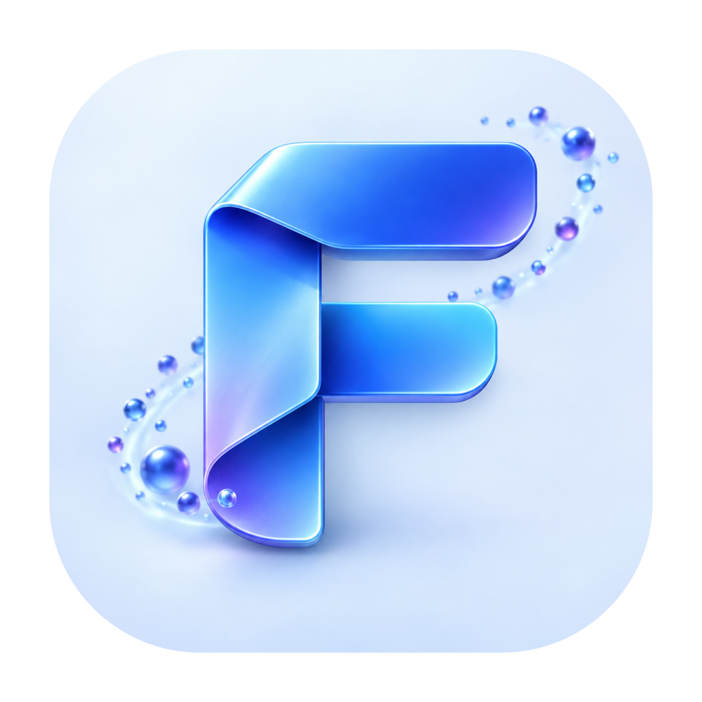
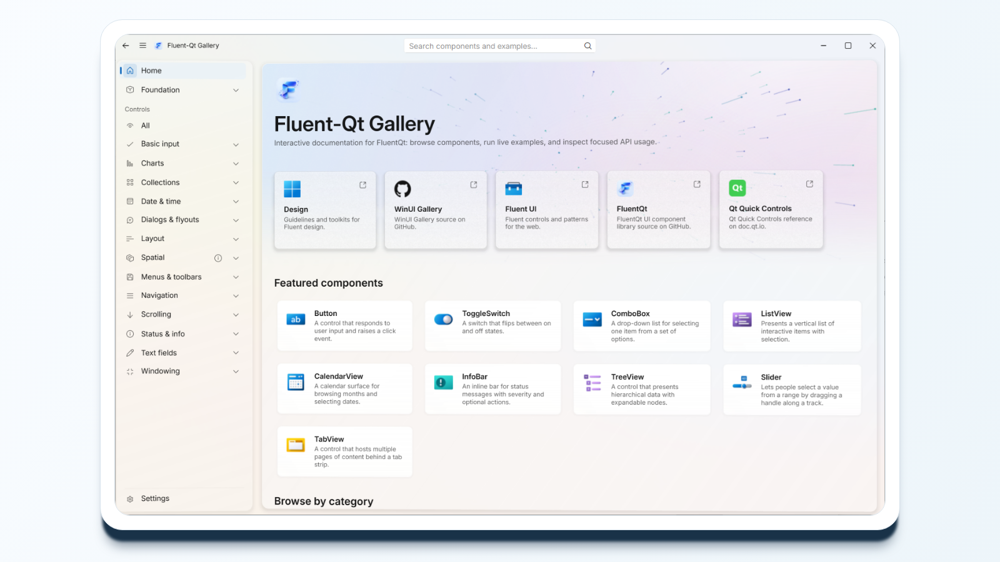

<p align="center">
  English | <a href="README.zh-CN.md">简体中文</a>
</p>

<p align="center">
  
</p>

<h1 align="center">Fluent-Qt</h1>

<p align="center">
  A cross-platform Fluent-style C++ UI component library for Qt Widgets.
</p>

<p align="center">
  <a href="https://github.com/calvinhxx/Fluent-Qt/actions/workflows/ci.yml"></a>
  <a href="https://github.com/calvinhxx/Fluent-Qt/stargazers"></a>
  <a href="LICENSE"></a>
  
  
  
  
  <a href="https://pypi.org/project/FluentQt/"></a>
</p>

<p align="center">
  <a href="https://calvinhxx.github.io/Fluent-Qt/#top"></a>
</p>

<p align="center">
  <strong><a href="https://calvinhxx.github.io/Fluent-Qt/#gallery">Try the live C++ Web Gallery</a></strong>
  ·
  <a href="https://calvinhxx.github.io/Fluent-Qt/#top">Project website</a>
  ·
  <a href="https://github.com/calvinhxx/Fluent-Qt/discussions">Questions &amp; community</a>
</p>

Fluent-Qt (FluentQt) is a cross-platform, Fluent-style C++ UI component library built on Qt Widgets. It provides native controls for input, navigation, collections, data grids, [charts](docs/architecture/charts.md), overlays, and windows. Written in C++17, it integrates into existing Qt projects through CMake and offers optional PySide6 bindings.

The library supports Windows, macOS, Linux, and WebAssembly. It includes Light, Dark, and High Contrast themes, with options to reduce or disable motion. The optional [Spatial](docs/architecture/spatial-view.md) plugin adds 3D presentation to Widgets interfaces. [QmlBridge](docs/architecture/qml-bridge.md) provides QML support, loading QML pages that share application data and Fluent theme settings with Widgets.

## 🧩 Library modules

### Core

`FluentQt::FluentQt` provides native controls, themes, design tokens, and shared
widget foundations. Ordinary 2D applications only need this target.

### Plugins

The optional [Plugins](docs/architecture/plugins.md) module handles registration,
dependencies, activation, and cleanup. C++ applications link `FluentQt::Plugins`;
each plugin has its own target for any extra dependencies.

C++ applications call the library directly. Python uses matching PySide6 bindings,
and WebAssembly builds compile the same C++ code to run in the browser.

#### Spatial

The [Spatial](docs/architecture/spatial-view.md) plugin adds 3D presentation to
existing Qt Widgets interfaces. `SpatialSession` activates the plugin, creates views,
and cleans up when the plugin stops.

Linking `FluentQt::Spatial` also links `FluentQt::Plugins` and adds OpenGL
dependencies. Spatial supports a native 2D fallback when 3D is unavailable.

Open Plugins → Spatial in Gallery to see SpatialView and SpatialItem examples.
Turn on 3D in Settings → 3D Gallery.

#### QmlBridge

[QmlBridge](docs/architecture/qml-bridge.md) is FluentQt's QML compatibility
plugin. It loads QML pages in Widgets interfaces and shares application data
and Fluent theme settings with the page.

Enable `FLUENT_QT_BUILD_QML_BRIDGE=ON` and link `FluentQt::QmlBridge`. This
optional module adds the Qt Qml, Quick, and QuickWidgets dependencies.

Try Plugins → QmlBridge → QmlView in Gallery, or build the
[minimal example](examples/qml_bridge/). Setup details are in the
[integration guide](docs/architecture/qml-bridge.md).

## 🖼 Gallery

Use Gallery to browse controls, try interactions, and read example code.

| Try it on | Entry point |
|---|---|
| Browser | [Live Gallery](https://calvinhxx.github.io/Fluent-Qt/gallery/) · [Project website](https://calvinhxx.github.io/Fluent-Qt/#gallery) |
| Windows, macOS, Linux | [Download a Gallery package](https://github.com/calvinhxx/Fluent-Qt/releases/latest) |

### Python compatibility Gallery

The Python Gallery is available from
[PyPI](https://pypi.org/project/FluentQt-Gallery/).

```bash
python -m pip install FluentQt-Gallery
python -m fluentqt_gallery
```

`FluentQt-Gallery` installs the matching `FluentQt` version automatically.

## 🤖 Build with AI

Use [`build-fluentqt-gui`](.agents/skills/build-fluentqt-gui/SKILL.md) in Codex, Claude Code, or Cursor to build a desktop app, add a GUI to a project, or fix an interface. [Example](https://calvinhxx.github.io/Fluent-Qt/#ai-build) · [Install and use](docs/ai/README.md)

When tuning a Gallery sample, use Live Scene to see each saved change, then check the result in the compiled C++ sample. [How it works](docs/development/gallery-preview-workflow.md)

## 🚀 Quick Start

The C++ integration requires C++17, CMake 3.16+, and Qt Widgets 5.15+ or 6.2+. Use `FetchContent` for new projects.

### C++ setup

#### `FetchContent` integration

```cmake
cmake_minimum_required(VERSION 3.16)
project(my_app LANGUAGES CXX)

set(CMAKE_CXX_STANDARD 17)
set(CMAKE_CXX_STANDARD_REQUIRED ON)

include(FetchContent)
FetchContent_Declare(
    fluentqt
    GIT_REPOSITORY https://github.com/calvinhxx/Fluent-Qt.git
    GIT_TAG v1.10.0
    GIT_SHALLOW TRUE
)
FetchContent_MakeAvailable(fluentqt)

add_executable(my_app main.cpp)
target_link_libraries(my_app PRIVATE FluentQt::FluentQt)
```

#### Source integration

After defining your application target, add the Fluent-Qt source directory and
link the exported target:

```cmake
add_subdirectory(Fluent-Qt)
target_link_libraries(my_app PRIVATE FluentQt::FluentQt)
```

#### Installed library integration

Use a FluentQt installation that includes the development headers and CMake
package files. See the [library build and installation guide](docs/development/build-workflow.md#install-the-library-or-create-a-source-package).

```cmake
find_package(FluentQt CONFIG REQUIRED)
target_link_libraries(my_app PRIVATE FluentQt::FluentQt)
```

If FluentQt is outside the system search path, configure with `-DCMAKE_PREFIX_PATH=/path/to/fluentqt`.

### C++ minimal example

`main.cpp`:

```cpp
#include <FluentQt/FluentQt.h>

#include <QApplication>
#include <QVBoxLayout>
#include <QWidget>

int main(int argc, char* argv[])
{
    fluent::prepareHighDpiApplication();
    QApplication app(argc, argv);
    fluent::initializeResources();
    app.setFont(Typography::fontStyle(Typography::FontRole::Body).toQFont());

    fluent::windowing::Window window;
    window.setWindowTitle(QStringLiteral("FluentQt Hello World"));
    window.resize(480, 320);

    auto* content = new QWidget;
    auto* layout = new QVBoxLayout(content);
    layout->setContentsMargins(32, 32, 32, 32);

    auto* button = new fluent::basicinput::Button(
        QStringLiteral("Hello from FluentQt"), content);
    button->setFluentStyle(fluent::basicinput::Button::Accent);
    layout->addStretch();
    layout->addWidget(button, 0, Qt::AlignCenter);
    layout->addStretch();

    window.setContentWidget(content);
    window.show();
    return app.exec();
}
```

See [`examples/hello_world`](examples/hello_world/) for the complete project, or run the `fluentqt_hello_world` target directly from an IDE.

### Optional Python compatibility

The PySide6 compatibility layer exposes Fluent-Qt's native C++ widgets to
Python through Shiboken6.

```bash
python -m pip install FluentQt
```

See the [Python guide](bindings/pyside6/README.md) for installation,
examples, compatibility, and source builds.

## 🛠 Build

### Dependencies

| Scope | Dependencies |
|---|---|
| FluentQt C++ library | C++17, CMake 3.16+, Qt Widgets 5.15+ or 6.2+ |
| C++ Gallery | FluentQt, Qt Network, spdlog/fmt |
| C++ WebAssembly | Qt 6.9.3 `wasm_singlethread`, Emscripten 3.1.70 |
| Tests | FluentQt, Qt Test/Network, GTest, spdlog/fmt |
| Optional PySide6 bindings | Qt/PySide6/Shiboken6 6.2.4+; Python 3.10+ for source builds |

### Library

```bash
cmake -S . -B build/fluentqt \
  -DCMAKE_BUILD_TYPE=Release \
  -DCMAKE_PREFIX_PATH=/path/to/Qt
python3 tools/dev/fluent_qt_build.py build/fluentqt --config Release --target FluentQt
cmake --install build/fluentqt --config Release \
  --component Development --prefix /path/to/install
```

The build script selects parallelism from available CPU and memory.
See the [build workflow](docs/development/build-workflow.md) for configuration.

### Optional extensions

Enable the Plugins infrastructure or a plugin module when configuring FluentQt,
then link the corresponding target in your application.

| Extension scope | Build option | CMake target | Integration example |
|---|---|---|---|
| Plugins infrastructure | `-DFLUENT_QT_BUILD_PLUGINS=ON` | `FluentQt::Plugins` | [Minimal plugin example](docs/architecture/plugins.md#minimal-extension-example) |
| Plugins → Spatial | `-DFLUENT_QT_BUILD_SPATIAL=ON` | `FluentQt::Spatial` (automatically includes Plugins) | [Spatial Hello World](examples/hello_world/README.md) |
| Plugins → QmlBridge | `-DFLUENT_QT_BUILD_QML_BRIDGE=ON` | `FluentQt::QmlBridge` (automatically includes Plugins) | [QML host example](examples/qml_bridge/) |

For source integration, set the option before `add_subdirectory()` or
`FetchContent_MakeAvailable()`. See each module's guide for installed-package
integration. Matched Python builds expose enabled modules through
`fluentqt.plugins`, `fluentqt.spatial`, and `fluentqt.qmlbridge`. WebAssembly uses
the shared C++ implementation.

### Build Gallery locally

Repository presets require CMake 3.25+ and `VCPKG_ROOT`. Configure your Qt kit
using the [first-use setup](docs/development/build-workflow.md#first-use-setup).

List the presets available on the current host:

```bash
cmake --list-presets
```

On Apple Silicon, use `vcpkg-osx`:

```bash
cmake --preset vcpkg-osx
python3 tools/dev/fluent_qt_build.py \
  --preset vcpkg-osx \
  --target fluent_qt_gallery
```

Use the matching preset on other platforms:

| Platform | Preset |
|---|---|
| Apple Silicon Mac | `vcpkg-osx` |
| Intel Mac or Rosetta | `vcpkg-osx-x64` |
| Linux x64 | `vcpkg-linux` |
| Linux ARM64 | `vcpkg-linux-arm64` |
| Windows x64 | `vcpkg-windows` |
| Windows ARM64 | `vcpkg-windows-arm64` |

For packaging, use the matching `-release` preset and the verification
steps in the [packaging workflow](docs/development/packaging-workflow.md).

### WebAssembly

See the [WebAssembly workflow](docs/development/webassembly-workflow.md) for
the browser toolchain, local builds, validation, and Pages deployment.

### Source package

Create the reduced library source package for offline or source integration:

```bash
python3 tools/dev/fluent_qt_build.py build/fluentqt --target fluent_qt_source_package
```

## 📚 Documentation

Start with the [documentation map](docs/README.md), or choose a path:

| Goal | Entry point |
|---|---|
| Evaluate controls | [API Explorer](https://calvinhxx.github.io/Fluent-Qt/api/) · [WebAssembly Gallery](https://calvinhxx.github.io/Fluent-Qt/gallery/) |
| Build an application | [AI-assisted development](docs/ai/README.md) · [Onboarding tools](tools/onboarding/README.md) |
| Contribute to FluentQt | [Development tree](docs/development/README.md) · [Architecture](docs/architecture/README.md) · [Fluent design](docs/design-languages/README.md) |
| Package or release | [Packaging](docs/development/packaging-workflow.md) · [Release governance](docs/development/release-governance.md) · [Release notes](docs/releases/README.md) |
| Get help or report a problem | [Community](docs/community/README.md) · [Support](SUPPORT.md) · [Security](SECURITY.md) |

See [Contributing](CONTRIBUTING.md) and the
[Code of Conduct](CODE_OF_CONDUCT.md) before opening a change.

## 🔗 References

| Entry | Purpose |
|---|---|
| [Windows UI Kit (Community)](https://www.figma.com/design/qpecbg7hOfos9DcHWeKlfw/Windows-UI-kit--Community-?node-id=2434-129659) | Fluent / Windows visual reference |
| [WinUI Gallery](https://github.com/microsoft/WinUI-Gallery) | Component behavior and sample page reference |

## License

Fluent-Qt's own source code is released under the [MIT License](LICENSE). Bundled assets and packaged runtime dependencies retain their upstream terms; versions, provenance, source-availability rules, and license locations are listed in [THIRD_PARTY_NOTICES.md](THIRD_PARTY_NOTICES.md). Product names, logos, and external design references are addressed in [TRADEMARKS.md](TRADEMARKS.md).
