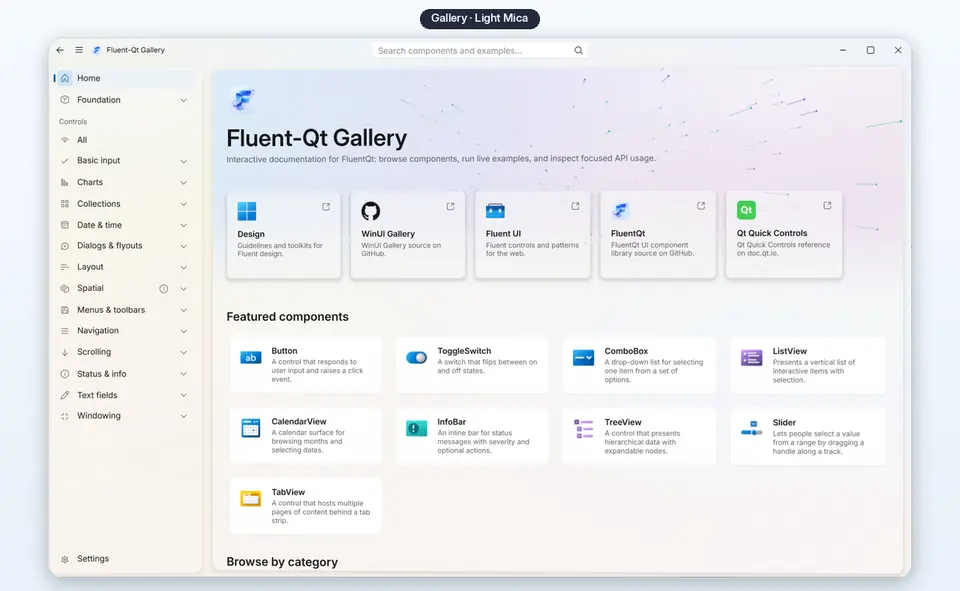
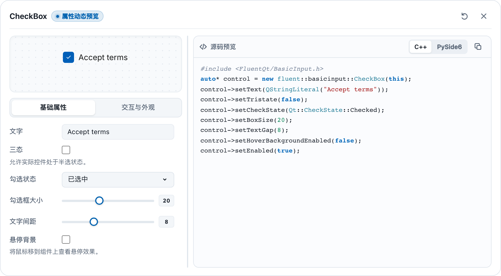
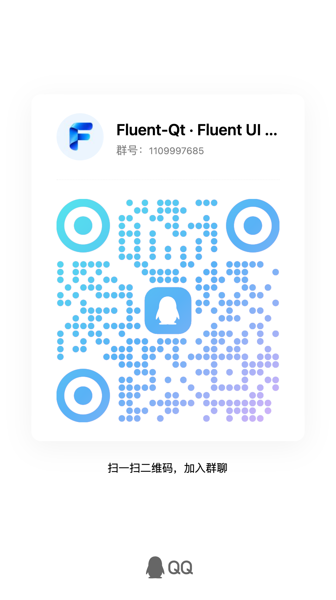

<p align="center">
  <a href="README.md">English</a> | 简体中文 | <a href="README.zh-TW.md">繁體中文</a> | <a href="README.ja.md">日本語</a> | <a href="README.ko.md">한국어</a> | <a href="README.de.md">Deutsch</a> | <a href="README.ru.md">Русский</a> | <a href="README.es.md">Español</a> | <a href="README.fr.md">Français</a>
</p>

<p align="center">
  
</p>

<h1 align="center">Fluent-Qt</h1>

<p align="center">
  MIT 开源协议的 Qt Widgets 原生 Fluent UI 组件库——一套 C++17 内核同时驱动 C++、PySide6 与 WebAssembly。
</p>

<p align="center">
  <a href="https://github.com/calvinhxx/Fluent-Qt/actions/workflows/ci.yml"></a>
  <a href="https://github.com/calvinhxx/Fluent-Qt/stargazers"></a>
  <a href="LICENSE"></a>
  
  
  
  
  <a href="bindings/pyside6/README.md"></a>
  <a href="https://pypi.org/project/FluentQt/"></a>
</p>

<p align="center">
  <a href="https://calvinhxx.github.io/Fluent-Qt/zh-CN/#gallery"></a>
</p>

<p align="center">
  <strong><a href="https://calvinhxx.github.io/Fluent-Qt/zh-CN/#gallery">实时体验 C++ Web Gallery</a></strong>
  ·
  <strong><a href="https://calvinhxx.github.io/Fluent-Qt/studio/?lang=zh">Page Studio</a></strong>
  ·
  <strong><a href="https://calvinhxx.github.io/Fluent-Qt/zh-CN/api/checkbox/?playground=1">属性动态预览</a></strong>
  ·
  <a href="https://calvinhxx.github.io/Fluent-Qt/zh-CN/api/">组件与 API 文档</a>
  ·
  <a href="https://calvinhxx.github.io/Fluent-Qt/zh-CN/#top">项目官网</a>
  ·
  <a href="https://github.com/calvinhxx/Fluent-Qt/discussions">提问与交流</a>
  ·
  <a href="https://calvinhxx.github.io/Fluent-Qt/zh-CN/#support">支持项目</a>
</p>

Fluent-Qt（FluentQt）用同一套原生 C++17 实现为 C++、PySide6 与 WebAssembly 提供 Fluent UI 桌面与浏览器控件：

- **MIT 协议免费商用** — C++17 基础库、PySide6 绑定、Qt Designer 插件与项目模板均采用 MIT 许可证，个人与商业闭源项目可放心集成。
- **C++ / Python / WASM 同源原生内核** — Gallery 收录 99 项（含 `DataGrid`、[图表](docs/architecture/charts.md)、导航、浮层、对话框与窗口），并非单纯 QSS 换肤，同一份 C++17 控件代码支持 `Qt 5.15+`/`6.2+`、`PySide6` 与 `WebAssembly`。
- **Page Studio + Qt Designer 可视化设计** — 可在浏览器 **Page Studio** 中实时预览并导出 C++、PySide6 或 `.ui` 文件，也支持在 **Qt Creator** 与 `pyside6-designer` 中拖拽 95 项控件与 4 套表单模板。
- **开箱即用的应用脚手架与 AI Skill** — 通过 `python3 tools/onboarding/fluentqt` 一键生成分层清晰的 `monitor`、`workbench` 或 `existing-qt` 工程，并配套 [`build-fluentqt-gui`](.agents/skills/build-fluentqt-gui/SKILL.md) Skill 辅助界面开发。
- **按需启用扩展能力** — 普通 2D 应用仅依赖 `Qt Widgets`；可按需链接 CPU 粒子背景（[Particles](docs/architecture/particles.md)）、3D 透视视图（[Spatial](docs/architecture/spatial-view.md)）或 QML 混排宿主（[QmlBridge](docs/architecture/qml-bridge.md)）。

## 🧩 模块概览

| 模块 | CMake 目标 | 说明 |
|---|---|---|
| Core 基础库 | `FluentQt::FluentQt` | 全部 2D 控件、主题配色、字号、布局与图表。普通 2D 应用只需链接此目标。 |
| [Plugins](docs/architecture/plugins.md) | `FluentQt::Plugins` | 应用内插件注册、依赖排序、按序启停与清理。 |
| [Particles](docs/architecture/particles.md) | `FluentQt::Particles` | CPU 绘制的粒子动态背景 `ParticleBackdrop`（无需 OpenGL），支持通过 `ParticlesSession` 统一暂停与恢复。 |
| [Spatial](docs/architecture/spatial-view.md) | `FluentQt::Spatial` | 为现有 `QWidget` 布局添加透视效果。会话启动或视图创建失败时，由应用提供 [2D 布局](examples/hello_world/README.md)。 |
| [QmlBridge](docs/architecture/qml-bridge.md) | `FluentQt::QmlBridge` | 通过 `QmlView` 在 Widgets 窗口中嵌入 QML 页面，并共享业务数据与 Fluent 主题。 |

C++ 直接链接上述目标，Python 使用对应的 PySide6 模块，WebAssembly 由同一套 C++ 代码编译并在浏览器中运行。可在 Gallery 的 **Plugins → Particles**、**Plugins → Spatial**（在 **Settings → 3D Gallery** 中开启 3D）和 **Plugins → QmlBridge → QmlView** 中体验示例，或参考 [QML 最小示例](examples/qml_bridge/)。

## 🖼 Gallery 与官网文档

使用 Gallery 浏览全部控件、体验交互效果，并对照查看 C++ 和 Python 示例代码。

| 体验方式 | 入口 |
|---|---|
| 浏览器（WebAssembly Gallery） | [在线 Gallery](https://calvinhxx.github.io/Fluent-Qt/gallery/) · [项目官网](https://calvinhxx.github.io/Fluent-Qt/zh-CN/#gallery) |
| 官网文档与属性动态预览 | [组件与 API 文档](https://calvinhxx.github.io/Fluent-Qt/zh-CN/api/) · [在线试用属性预览](https://calvinhxx.github.io/Fluent-Qt/zh-CN/api/checkbox/?playground=1) |
| Windows、macOS、Linux | [下载 Gallery 安装包](https://github.com/calvinhxx/Fluent-Qt/releases/latest) |

### 组件文档与属性动态预览

[官网文档](https://calvinhxx.github.io/Fluent-Qt/zh-CN/api/)包含基础指南、99 个组件 API 与[版本记录](https://calvinhxx.github.io/Fluent-Qt/zh-CN/api/releases/)。打开任意组件页的**属性动态预览**，即可在线调整控件属性并复制生成的 C++ / PySide6 代码：

<p>
  <a href="https://calvinhxx.github.io/Fluent-Qt/zh-CN/api/checkbox/?playground=1">
    
  </a>
</p>

快速体验：[Button](https://calvinhxx.github.io/Fluent-Qt/zh-CN/api/button/?playground=1) · [CheckBox](https://calvinhxx.github.io/Fluent-Qt/zh-CN/api/checkbox/?playground=1) · [ComboBox](https://calvinhxx.github.io/Fluent-Qt/zh-CN/api/combobox/?playground=1) · [DataGrid](https://calvinhxx.github.io/Fluent-Qt/zh-CN/api/data-grid/?playground=1) · [LineChart](https://calvinhxx.github.io/Fluent-Qt/zh-CN/api/line-chart/?playground=1) · [ParticleBackdrop](https://calvinhxx.github.io/Fluent-Qt/zh-CN/api/particle-backdrop/?playground=1) · [SpatialView](https://calvinhxx.github.io/Fluent-Qt/zh-CN/api/spatial-view/?playground=1) · [QmlView](https://calvinhxx.github.io/Fluent-Qt/zh-CN/api/qml-view/?playground=1)

### Python Gallery

从 [PyPI](https://pypi.org/project/FluentQt-Gallery/) 安装 Python 版 Gallery（会自动安装配套版本的 `FluentQt`）：

```bash
python -m pip install FluentQt-Gallery
python -m fluentqt_gallery
```

## 🎨 可视化设计

- **Page Studio（网页端）**：在浏览器中使用 [Page Studio](https://calvinhxx.github.io/Fluent-Qt/studio/?lang=zh) 拖拽编排 Fluent-Qt 控件，支持从模板或 AI 辅助布局起步、实时预览交互，并导出 C++、PySide6 或 Qt Designer `.ui` 文件。

### Qt Designer

安装全部模块后，Qt Creator 和 `pyside6-designer` 的工具箱里有 95 项，另有 4 个模板从“新建表单”选择。仅安装核心模块时分别为 92 项和 3 个模板。见 [Designer 安装指南](tools/designer/README.md)。

<p>
  <a href="tools/designer/README.md">
    
  </a>
</p>

## 🤖 AI 辅助开发

**AI Skill 与项目脚手架**：在 Codex、Claude Code 或 Cursor 中使用 [`build-fluentqt-gui`](.agents/skills/build-fluentqt-gui/SKILL.md) Skill（[查看示例](https://calvinhxx.github.io/Fluent-Qt/zh-CN/#ai-build) · [安装与用法](docs/ai/README.md)），并可通过 `python3 tools/onboarding/fluentqt`（[环境检查与项目模板](tools/onboarding/README.md)）一键检测环境与生成分层的 C++ / PySide6 起步工程（`monitor`、`workbench`、`existing-qt`）。调整 Gallery 示例时，可先在 Live Scene 保存即预览再用编译后的 C++ 程序确认（[工作原理](docs/development/gallery-preview-workflow.md)）。

```bash
python3 tools/onboarding/fluentqt create my-monitor --language cpp --starter monitor
python3 tools/onboarding/fluentqt create my-py-monitor --language pyside6 --starter monitor
```

## 🚀 快速开始

Fluent-Qt 同时面向 **Python（PySide6）** 与 **C++17（CMake）** 原生提供同一套控件。

### Python (PySide6)

Qt/PySide6 6.9.3 预编译包支持 CPython 3.11–3.13。Linux ARM64 需要 CPython 3.12–3.13 和 glibc 2.39 或更高版本。

```bash
python -m pip install FluentQt
```

`main.py`：

```python
import sys
import fluentqt
from PySide6.QtCore import Qt
from PySide6.QtWidgets import QApplication, QVBoxLayout, QWidget
from fluentqt.basicinput import Button
from fluentqt.windowing import Window

fluentqt.prepare_high_dpi_application()
app = QApplication(sys.argv)
fluentqt.initialize_resources()
app.setFont(fluentqt.font_for_role(fluentqt.FontRole.Body))

window = Window()
window.resize(480, 320)
content = QWidget()
button = Button("Hello from FluentQt", content)
button.setFluentStyle(Button.ButtonStyle.Accent)
QVBoxLayout(content).addWidget(button, alignment=Qt.AlignmentFlag.AlignCenter)
window.setContentWidget(content)
window.show()
sys.exit(app.exec())
```

[Python 指南](bindings/pyside6/README.md) · [Hello World](bindings/pyside6/examples/hello_world/main.py)

### C++ 接入

C++ 接入需要 C++17、CMake 3.16+ 和 Qt Widgets 5.15+ 或 6.2+。新项目推荐使用 `FetchContent`。

#### `FetchContent` 集成

```cmake
cmake_minimum_required(VERSION 3.16)
project(my_app LANGUAGES CXX)

set(CMAKE_CXX_STANDARD 17)
set(CMAKE_CXX_STANDARD_REQUIRED ON)

include(FetchContent)
FetchContent_Declare(
    fluentqt
    GIT_REPOSITORY https://github.com/calvinhxx/Fluent-Qt.git
    GIT_TAG v1.12.3
    GIT_SHALLOW TRUE
)
FetchContent_MakeAvailable(fluentqt)

add_executable(my_app main.cpp)
target_link_libraries(my_app PRIVATE FluentQt::FluentQt)
```

#### 源码集成

定义好应用目标后，加入 Fluent-Qt 源码目录并链接导出目标：

```cmake
add_subdirectory(Fluent-Qt)
target_link_libraries(my_app PRIVATE FluentQt::FluentQt)
```

#### 已安装组件库集成

使用已安装的 FluentQt 开发头文件和 CMake 包文件，构建与安装方式见[组件库构建与安装指南](docs/development/build-workflow.md#install-the-library-or-create-a-source-package)。

```cmake
find_package(FluentQt CONFIG REQUIRED)
target_link_libraries(my_app PRIVATE FluentQt::FluentQt)
```

如果 FluentQt 不在系统搜索路径中，配置时传入 `-DCMAKE_PREFIX_PATH=/path/to/fluentqt`。

使用 vcpkg 管理依赖的 Qt 6 应用可以通过 [Fluent-Qt overlay port](docs/development/build-workflow.md#install-the-widgets-library-with-vcpkg) 安装 Widgets 核心库。

使用 Conan 2 的项目可以[在本地缓存中构建 Widgets 核心库](docs/development/build-workflow.md#build-the-widgets-library-with-conan-2)。

#### C++ 最小示例

`main.cpp`：

```cpp
#include <FluentQt/FluentQt.h>

#include <QApplication>
#include <QVBoxLayout>
#include <QWidget>

int main(int argc, char* argv[])
{
    fluent::prepareHighDpiApplication();
    QApplication app(argc, argv);
    fluent::initializeResources();
    app.setFont(Typography::fontStyle(Typography::FontRole::Body).toQFont());

    fluent::windowing::Window window;
    window.setWindowTitle(QStringLiteral("FluentQt Hello World"));
    window.resize(480, 320);

    auto* content = new QWidget;
    auto* layout = new QVBoxLayout(content);
    layout->setContentsMargins(32, 32, 32, 32);

    auto* button = new fluent::basicinput::Button(
        QStringLiteral("Hello from FluentQt"), content);
    button->setFluentStyle(fluent::basicinput::Button::Accent);
    layout->addStretch();
    layout->addWidget(button, 0, Qt::AlignCenter);
    layout->addStretch();

    window.setContentWidget(content);
    window.show();
    return app.exec();
}
```

完整工程见 [`examples/hello_world`](examples/hello_world/)，IDE 中可直接运行 `fluentqt_hello_world` target。

## 🛠 构建

### 依赖

| 范围 | 依赖 |
|---|---|
| FluentQt C++ 组件库 | C++17、CMake 3.16+、Qt Widgets 5.15+ 或 6.2+ |
| C++ Gallery | FluentQt、Qt Network、spdlog/fmt |
| C++ WebAssembly | Qt 6.9.3 `wasm_singlethread`、Emscripten 3.1.70 |
| 测试 | FluentQt、Qt Test/Network、GTest、spdlog/fmt |
| 可选 PySide6 绑定 | Qt/PySide6/Shiboken6 6.2.4+；源码构建支持 Python 3.10+ |

### 组件库

```bash
cmake -S . -B build/fluentqt \
  -DCMAKE_BUILD_TYPE=Release \
  -DCMAKE_PREFIX_PATH=/path/to/Qt
python3 tools/dev/fluent_qt_build.py build/fluentqt --config Release --target FluentQt
cmake --install build/fluentqt --config Release \
  --component Development --prefix /path/to/install
```

构建脚本根据可用 CPU 和内存选择并行任务数，配置方法见[构建工作流](docs/development/build-workflow.md)。

### 可选扩展

配置 FluentQt 时按需开启 Plugins 模块或具体插件，然后在应用中链接对应的 CMake 目标：

| 扩展模块 | 构建选项 | CMake 目标 | 接入示例 |
|---|---|---|---|
| Plugins 插件管理 | `-DFLUENT_QT_BUILD_PLUGINS=ON` | `FluentQt::Plugins` | [最小插件示例](docs/architecture/plugins.md#minimal-extension-example) |
| Plugins → Particles | `-DFLUENT_QT_BUILD_PARTICLES=ON` | `FluentQt::Particles` | [粒子接入](docs/architecture/particles.md) |
| Plugins → Spatial | `-DFLUENT_QT_BUILD_SPATIAL=ON` | `FluentQt::Spatial`（自动包含 Plugins） | [Spatial Hello World](examples/hello_world/README.md) |
| Plugins → QmlBridge | `-DFLUENT_QT_BUILD_QML_BRIDGE=ON` | `FluentQt::QmlBridge`（自动包含 Plugins） | [QML 宿主示例](examples/qml_bridge/) |

源码集成时，请在 `add_subdirectory()` 或 `FetchContent_MakeAvailable()` 前开启这些选项。匹配的 Python 构建会导出 `fluentqt.plugins`、`fluentqt.spatial` 和 `fluentqt.qmlbridge`，WebAssembly 则直接编译同一份 C++ 实现。

### 本地构建 Gallery

仓库预设需要 CMake 3.25+ 和 `VCPKG_ROOT`。本机 Qt kit 的配置方法见[首次配置](docs/development/build-workflow.md#first-use-setup)。

先查看当前平台可用的构建配置：

```bash
cmake --list-presets
```

Apple Silicon Mac 使用 `vcpkg-osx`：

```bash
cmake --preset vcpkg-osx
python3 tools/dev/fluent_qt_build.py \
  --preset vcpkg-osx \
  --target fluent_qt_gallery
```

其他平台使用对应的 preset：

| 平台 | preset |
|---|---|
| Apple Silicon Mac | `vcpkg-osx` |
| Intel Mac 或 Rosetta | `vcpkg-osx-x64` |
| Linux x64 | `vcpkg-linux` |
| Linux ARM64 | `vcpkg-linux-arm64` |
| Windows x64 | `vcpkg-windows` |
| Windows ARM64 | `vcpkg-windows-arm64` |

打包时使用对应的 `-release` preset，并遵循[打包工作流](docs/development/packaging-workflow.md)中的验证步骤。

### WebAssembly

浏览器版本的工具链、本地构建、验证和 Pages 部署见 [WebAssembly 工作流](docs/development/webassembly-workflow.md)。

### 源码包

生成用于离线或源码集成的精简组件库源码包：

```bash
python3 tools/dev/fluent_qt_build.py build/fluentqt --target fluent_qt_source_package
```

## 📚 文档

可以从[文档导航](docs/README.md)开始，或按使用目标直接进入：

| 目标 | 入口 |
|---|---|
| 查看控件与 API | [组件与 API 文档](https://calvinhxx.github.io/Fluent-Qt/zh-CN/api/) · [WebAssembly Gallery](https://calvinhxx.github.io/Fluent-Qt/zh-CN/#gallery) |
| 开发桌面应用 | [Qt Designer](tools/designer/README.md) · [AI 辅助开发](docs/ai/README.md) · [环境检查与项目模板](tools/onboarding/README.md) |
| 参与项目开发 | [开发指南](docs/development/README.md) · [架构约定](docs/architecture/README.md) · [Fluent 设计规范](docs/design-languages/README.md) |
| 打包与发布 | [打包流程](docs/development/packaging-workflow.md) · [发布规范](docs/development/release-governance.md) · [更新日志](docs/releases/README.md) |
| 反馈问题或交流 | [社区入口](docs/community/README.md) · [支持说明](SUPPORT.md) · [安全报告](SECURITY.md) |
| 中文交流群 | QQ 群 `1109997685` |

QQ 群适合日常答疑、效果交流与协作；需要长期跟踪的问题或建议请提交到 GitHub Discussions 或 Issues。

<p align="center">
  
</p>

提交改动前请先阅读[参与贡献](CONTRIBUTING.md)与[社区行为准则](CODE_OF_CONDUCT.md)。

## 🔗 参考

| 来源 | 用途 |
|---|---|
| [Windows UI Kit (Community)](https://www.figma.com/design/qpecbg7hOfos9DcHWeKlfw/Windows-UI-kit--Community-?node-id=2434-129659) | Fluent / Windows 视觉参考 |
| [WinUI Gallery](https://github.com/microsoft/WinUI-Gallery) | 组件交互与示例页面参考 |

## 许可证

Fluent-Qt 源代码基于 [MIT License](LICENSE) 开源。内置字体、资源及安装包中包含的第三方依赖仍遵循各自上游许可证，详见[第三方声明](THIRD_PARTY_NOTICES.md)；产品名称、徽标与外部设计参考说明见[商标与外部引用声明](TRADEMARKS.md)。
