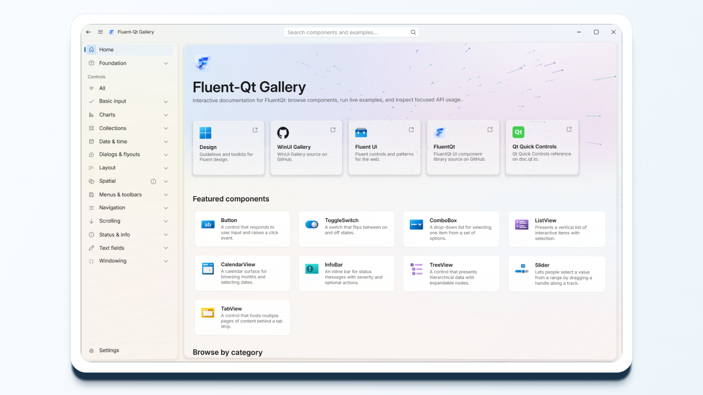

<p align="center">
  <a href="README.md">English</a> | <a href="README.zh-CN.md">简体中文</a> | 繁體中文 | <a href="README.ja.md">日本語</a> | <a href="README.ko.md">한국어</a> | <a href="README.de.md">Deutsch</a> | <a href="README.ru.md">Русский</a> | <a href="README.es.md">Español</a> | <a href="README.fr.md">Français</a>
</p>

<p align="center">
  
</p>

<h1 align="center">Fluent-Qt</h1>

<p align="center">
  面向 Qt Widgets 的跨平台 Fluent 風格 C++ UI 元件庫。
</p>

<p align="center">
  <a href="https://github.com/calvinhxx/Fluent-Qt/actions/workflows/ci.yml"></a>
  <a href="https://github.com/calvinhxx/Fluent-Qt/stargazers"></a>
  <a href="LICENSE"></a>
  
  
  
  
  <a href="https://pypi.org/project/FluentQt/"></a>
</p>

<p align="center">
  <a href="https://calvinhxx.github.io/Fluent-Qt/zh-TW/#top"></a>
</p>

<p align="center">
  <strong><a href="https://calvinhxx.github.io/Fluent-Qt/zh-TW/#gallery">線上體驗 C++ Web Gallery</a></strong>
  ·
  <strong><a href="https://calvinhxx.github.io/Fluent-Qt/zh-TW/api/checkbox/?playground=1">屬性動態預覽</a></strong>
  ·
  <a href="https://calvinhxx.github.io/Fluent-Qt/zh-TW/api/">文件與 API</a>
  ·
  <a href="https://calvinhxx.github.io/Fluent-Qt/zh-TW/#top">專案官網</a>
  ·
  <a href="https://github.com/calvinhxx/Fluent-Qt/discussions">提問與交流</a>
  ·
  <a href="https://calvinhxx.github.io/Fluent-Qt/zh-TW/#support">支持專案</a>
</p>

Fluent-Qt（FluentQt）為 Qt Widgets 提供一套 Fluent 風格控制項，涵蓋輸入、導覽、清單與樹狀檢視、資料表、[圖表](docs/architecture/charts.md)、對話方塊、浮層與視窗。以 C++17 開發，可透過 CMake 整合至現有 Qt 專案，並提供選用的 PySide6 繫結。

支援 Windows、macOS、Linux 與 WebAssembly，內建淺色、深色與高對比主題，並可設定動畫減弱或停用模式。按需啟用選用模組即可加入粒子背景（[Particles](docs/architecture/particles.md)）、3D 透視檢視（[Spatial](docs/architecture/spatial-view.md)）或嵌入 QML 頁面（[QmlBridge](docs/architecture/qml-bridge.md)）。

## 🧩 模組概覽

| 模組 | CMake 目標 | 用途 |
|---|---|---|
| Core 核心函式庫 | `FluentQt::FluentQt` | 所有 2D 控制項、主題配色、字型排版、版面輔助與圖表。一般 2D 應用程式僅需連結此目標。 |
| [Plugins](docs/architecture/plugins.md) | `FluentQt::Plugins` | 同行程內外掛註冊、相依性排序、啟停與清理。 |
| [Particles](docs/architecture/particles.md) | `FluentQt::Particles` | CPU 繪製的動態粒子背景（`ParticleBackdrop`，無需 OpenGL），並支援 `ParticlesSession` 暫停與恢復。 |
| [Spatial](docs/architecture/spatial-view.md) | `FluentQt::Spatial` | 為現有 `QWidget` 版面加上 3D 透視效果。若工作階段啟動或檢視建立失敗，由應用程式提供 [2D 版面](examples/hello_world/README.md)。 |
| [QmlBridge](docs/architecture/qml-bridge.md) | `FluentQt::QmlBridge` | 透過 `QmlView` 在 Widgets 視窗內嵌入 QML 頁面，同時共享應用程式資料模型與 Fluent 主題。 |

C++ 應用程式直接連結上述目標，Python 應用程式使用對應的 PySide6 模組，WebAssembly 則以同一套 C++ 程式碼編譯並在瀏覽器中執行。可在 Gallery 的 **Plugins → Particles**、**Plugins → Spatial**（先開啟 **Settings → 3D Gallery**）與 **Plugins → QmlBridge → QmlView** 體驗擴充範例，或參閱 [QML 最小範例](examples/qml_bridge/)。

## 🖼 Gallery 與線上文件

使用 Gallery 瀏覽全部控制項、體驗互動效果，並檢視 C++ 與 Python 範例程式碼。

| 體驗方式 | 入口 |
|---|---|
| 瀏覽器（WebAssembly Gallery） | [線上 Gallery](https://calvinhxx.github.io/Fluent-Qt/gallery/) · [專案官網](https://calvinhxx.github.io/Fluent-Qt/zh-TW/#gallery) |
| 線上文件與屬性動態預覽 | [基礎指南與 API](https://calvinhxx.github.io/Fluent-Qt/zh-TW/api/) · [試用屬性動態預覽](https://calvinhxx.github.io/Fluent-Qt/zh-TW/api/checkbox/?playground=1) |
| Windows、macOS、Linux | [下載 Gallery 安裝套件](https://github.com/calvinhxx/Fluent-Qt/releases/latest) |

### 元件文件與屬性動態預覽

[線上文件](https://calvinhxx.github.io/Fluent-Qt/zh-TW/api/)提供繁體中文的基礎指南、元件 API 參考與[版本紀錄](https://calvinhxx.github.io/Fluent-Qt/zh-TW/api/releases/)。在任一元件頁開啟 **屬性動態預覽**，即可即時調整 Qt 控制項屬性並複製產生的 C++ 或 PySide6 程式碼：

<p>
  <a href="https://calvinhxx.github.io/Fluent-Qt/zh-TW/api/checkbox/?playground=1">
    
  </a>
</p>

快速體驗：[Button](https://calvinhxx.github.io/Fluent-Qt/zh-TW/api/button/?playground=1) · [CheckBox](https://calvinhxx.github.io/Fluent-Qt/zh-TW/api/checkbox/?playground=1) · [ComboBox](https://calvinhxx.github.io/Fluent-Qt/zh-TW/api/combobox/?playground=1) · [DataGrid](https://calvinhxx.github.io/Fluent-Qt/zh-TW/api/data-grid/?playground=1) · [LineChart](https://calvinhxx.github.io/Fluent-Qt/zh-TW/api/line-chart/?playground=1) · [ParticleBackdrop](https://calvinhxx.github.io/Fluent-Qt/zh-TW/api/particle-backdrop/?playground=1) · [SpatialView](https://calvinhxx.github.io/Fluent-Qt/zh-TW/api/spatial-view/?playground=1) · [QmlView](https://calvinhxx.github.io/Fluent-Qt/zh-TW/api/qml-view/?playground=1)

### Python Gallery

從 [PyPI](https://pypi.org/project/FluentQt-Gallery/) 安裝 Python 版 Gallery（會自動安裝相容版本的 `FluentQt`）：

```bash
python -m pip install FluentQt-Gallery
python -m fluentqt_gallery
```

## 🤖 用 AI 建置介面

在 Codex、Claude Code 或 Cursor 中使用 [`build-fluentqt-gui`](.agents/skills/build-fluentqt-gui/SKILL.md) Skill，可建立桌面應用程式、為現有專案加上 GUI，或最佳化現有介面。[查看範例](https://calvinhxx.github.io/Fluent-Qt/zh-TW/#ai-build) · [安裝與用法](docs/ai/README.md)

調整 Gallery 範例時，請先在 Live Scene 即時預覽存檔後的修改，再編譯 C++ 範例驗證實際效果。[運作原理](docs/development/gallery-preview-workflow.md)

## 🚀 快速開始

C++ 整合需要 C++17、CMake 3.16+ 與 Qt Widgets 5.15+ 或 6.2+。新專案建議使用 `FetchContent`。

### C++ 設定

#### `FetchContent` 整合

```cmake
cmake_minimum_required(VERSION 3.16)
project(my_app LANGUAGES CXX)

set(CMAKE_CXX_STANDARD 17)
set(CMAKE_CXX_STANDARD_REQUIRED ON)

include(FetchContent)
FetchContent_Declare(
    fluentqt
    GIT_REPOSITORY https://github.com/calvinhxx/Fluent-Qt.git
    GIT_TAG v1.12.1
    GIT_SHALLOW TRUE
)
FetchContent_MakeAvailable(fluentqt)

add_executable(my_app main.cpp)
target_link_libraries(my_app PRIVATE FluentQt::FluentQt)
```

#### 原始碼整合

定義好應用程式目標後，加入 Fluent-Qt 原始碼目錄並連結匯出的目標：

```cmake
add_subdirectory(Fluent-Qt)
target_link_libraries(my_app PRIVATE FluentQt::FluentQt)
```

#### 已安裝函式庫整合

使用包含開發標頭檔與 CMake 套件檔的 FluentQt 安裝版本，詳見[函式庫建置與安裝指南](docs/development/build-workflow.md#install-the-library-or-create-a-source-package)。

```cmake
find_package(FluentQt CONFIG REQUIRED)
target_link_libraries(my_app PRIVATE FluentQt::FluentQt)
```

若 FluentQt 不在系統搜尋路徑中，請在設定時加上 `-DCMAKE_PREFIX_PATH=/path/to/fluentqt`。

### C++ 最小範例

`main.cpp`：

```cpp
#include <FluentQt/FluentQt.h>

#include <QApplication>
#include <QVBoxLayout>
#include <QWidget>

int main(int argc, char* argv[])
{
    fluent::prepareHighDpiApplication();
    QApplication app(argc, argv);
    fluent::initializeResources();
    app.setFont(Typography::fontStyle(Typography::FontRole::Body).toQFont());

    fluent::windowing::Window window;
    window.setWindowTitle(QStringLiteral("FluentQt Hello World"));
    window.resize(480, 320);

    auto* content = new QWidget;
    auto* layout = new QVBoxLayout(content);
    layout->setContentsMargins(32, 32, 32, 32);

    auto* button = new fluent::basicinput::Button(
        QStringLiteral("Hello from FluentQt"), content);
    button->setFluentStyle(fluent::basicinput::Button::Accent);
    layout->addStretch();
    layout->addWidget(button, 0, Qt::AlignCenter);
    layout->addStretch();

    window.setContentWidget(content);
    window.show();
    return app.exec();
}
```

完整專案見 [`examples/hello_world`](examples/hello_world/)，也可直接在 IDE 中執行 `fluentqt_hello_world` 目標。

### Python (PySide6)

透過 PyPI 安裝 PySide6 繫結（基於 Shiboken6）：

```bash
python -m pip install FluentQt
```

範例、相容性資訊與原始碼建置說明請參閱 [Python 指南](bindings/pyside6/README.md)。

## 🛠 建置

### 相依項目

| 範圍 | 相依項目 |
|---|---|
| FluentQt C++ 函式庫 | C++17、CMake 3.16+、Qt Widgets 5.15+ 或 6.2+ |
| C++ Gallery | FluentQt、Qt Network、spdlog/fmt |
| C++ WebAssembly | Qt 6.9.3 `wasm_singlethread`、Emscripten 3.1.70 |
| 測試 | FluentQt、Qt Test/Network、GTest、spdlog/fmt |
| 選用 PySide6 繫結 | Qt/PySide6/Shiboken6 6.2.4+；原始碼建置需 Python 3.10+ |

### 函式庫

```bash
cmake -S . -B build/fluentqt \
  -DCMAKE_BUILD_TYPE=Release \
  -DCMAKE_PREFIX_PATH=/path/to/Qt
python3 tools/dev/fluent_qt_build.py build/fluentqt --config Release --target FluentQt
cmake --install build/fluentqt --config Release \
  --component Development --prefix /path/to/install
```

建置腳本會依可用的 CPU 與記憶體決定並行度，設定細節見[建置工作流](docs/development/build-workflow.md)。

### 選用擴充模組

設定 FluentQt 時啟用 Plugins 模組或特定擴充，並在應用程式中連結對應的 CMake 目標：

| 擴充範圍 | 建置選項 | CMake 目標 | 整合範例 |
|---|---|---|---|
| Plugins 核心 | `-DFLUENT_QT_BUILD_PLUGINS=ON` | `FluentQt::Plugins` | [最小外掛範例](docs/architecture/plugins.md#minimal-extension-example) |
| Plugins → Particles | `-DFLUENT_QT_BUILD_PARTICLES=ON` | `FluentQt::Particles` | [Particles 整合](docs/architecture/particles.md) |
| Plugins → Spatial | `-DFLUENT_QT_BUILD_SPATIAL=ON` | `FluentQt::Spatial`（自動包含 Plugins） | [Spatial Hello World](examples/hello_world/README.md) |
| Plugins → QmlBridge | `-DFLUENT_QT_BUILD_QML_BRIDGE=ON` | `FluentQt::QmlBridge`（自動包含 Plugins） | [QML 宿主範例](examples/qml_bridge/) |

從原始碼建置時，請在 `add_subdirectory()` 或 `FetchContent_MakeAvailable()` 之前設定這些選項。對應的 Python 建置會匯出 `fluentqt.plugins`、`fluentqt.spatial` 與 `fluentqt.qmlbridge`，WebAssembly 則會編譯同一份 C++ 實作。

### 本機建置 Gallery

倉庫預設（preset）需要 CMake 3.25+ 與 `VCPKG_ROOT`。本機 Qt kit 的設定步驟請參閱[首次使用設定](docs/development/build-workflow.md#first-use-setup)。

列出目前主機可用的 presets：

```bash
cmake --list-presets
```

在 Apple Silicon 上使用 `vcpkg-osx`：

```bash
cmake --preset vcpkg-osx
python3 tools/dev/fluent_qt_build.py \
  --preset vcpkg-osx \
  --target fluent_qt_gallery
```

其他平台請使用對應的 preset：

| 平台 | Preset |
|---|---|
| Apple Silicon Mac | `vcpkg-osx` |
| Intel Mac 或 Rosetta | `vcpkg-osx-x64` |
| Linux x64 | `vcpkg-linux` |
| Linux ARM64 | `vcpkg-linux-arm64` |
| Windows x64 | `vcpkg-windows` |
| Windows ARM64 | `vcpkg-windows-arm64` |

封裝打包時請使用對應的 `-release` preset，並依照[打包工作流](docs/development/packaging-workflow.md)執行驗證步驟。

### WebAssembly

瀏覽器工具鏈、本機建置、驗證與 Pages 部署方式請參閱 [WebAssembly 工作流](docs/development/webassembly-workflow.md)。

### 原始碼套件

建立用於離線或原始碼整合的精簡函式庫原始碼套件：

```bash
python3 tools/dev/fluent_qt_build.py build/fluentqt --target fluent_qt_source_package
```

## 📚 文件

可從[文件導覽](docs/README.md)開始，或依需求直接前往對應入口：

| 目標 | 入口 |
|---|---|
| 瀏覽控制項與 API | [元件文件與 API](https://calvinhxx.github.io/Fluent-Qt/zh-TW/api/) · [WebAssembly Gallery](https://calvinhxx.github.io/Fluent-Qt/zh-TW/#gallery) |
| 建置應用程式 | [AI 輔助開發](docs/ai/README.md) · [新手入門工具](tools/onboarding/README.md) |
| 參與 FluentQt 開發 | [開發指南](docs/development/README.md) · [架構說明](docs/architecture/README.md) · [Fluent 設計規範](docs/design-languages/README.md) |
| 打包與發布 | [打包流程](docs/development/packaging-workflow.md) · [發布規範](docs/development/release-governance.md) · [版本紀錄](docs/releases/README.md) |
| 尋求協助或回報問題 | [社群入口](docs/community/README.md) · [支持說明](SUPPORT.md) · [安全性政策](SECURITY.md) |

送出 Pull Request 前，請先閱讀[參與貢獻](CONTRIBUTING.md)與[行為準則](CODE_OF_CONDUCT.md)。

## 🔗 參考資料

| 來源 | 用途 |
|---|---|
| [Windows UI Kit (Community)](https://www.figma.com/design/qpecbg7hOfos9DcHWeKlfw/Windows-UI-kit--Community-?node-id=2434-129659) | Fluent / Windows 視覺參考 |
| [WinUI Gallery](https://github.com/microsoft/WinUI-Gallery) | 控制項行為與範例頁面參考 |

## 授權條款

Fluent-Qt 自身的原始碼採用 [MIT License](LICENSE) 釋出。隨附資源與打包的執行期相依元件仍保有各自的上游授權；版本、來源、原始碼取得方式與授權詳情列於 [THIRD_PARTY_NOTICES.md](THIRD_PARTY_NOTICES.md)。商標與第三方設計參考說明請參閱 [TRADEMARKS.md](TRADEMARKS.md)。
