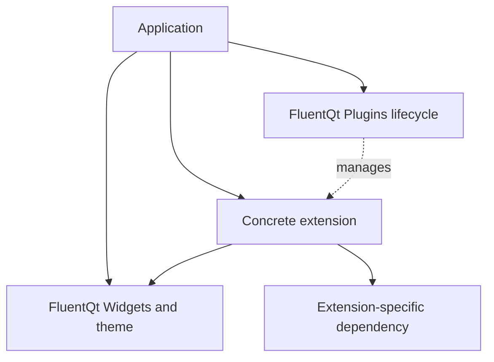

# Plugins: optional extension lifecycle

> **Status:** Accepted contract

<!-- docs-nav:top:start -->
[Documentation](../README.md) › [Architecture](README.md) › Runtime contracts

[← QMLPlus reactive composition](qmlplus.md) · [Contents](../SUMMARY.md) · [Architecture index](README.md) · [QmlBridge: application QML in a QWidget host →](qml-bridge.md)
<!-- docs-nav:top:end -->

`FluentQt::Plugins` provides a common lifecycle for application-supplied
extensions. An extension can expose nonvisual capabilities, create ordinary
Fluent widgets, or adapt external content. The module manages registration,
dependency order, activation, and cleanup; each concrete extension owns its
implementation and additional dependencies.

The public types live in `src/components/foundation/plugins`, use
`fluent::plugins`, and are installed through `<FluentQt/Plugins.h>`.
Applications linked to `FluentQt::Plugins` can also include
`<FluentQt/FluentQt.h>`. The optional target uses the existing Qt Widgets
dependencies and supports C++17 with Qt 5.15+ or 6.2+. Matched PySide6 source
builds expose the same lifecycle through `fluentqt.plugins`. WebAssembly
applications compile the shared C++ module into their browser executable.

## Module boundary



C++ applications construct plugin objects from code linked into their
executable; Python applications instantiate bindings and their own subclasses.
`PluginManager` does not discover files or load shared libraries.
The contract does not provide a marketplace, hot unloading, a dynamic binary
interface, or dependency version negotiation. `PluginMetadata::version` is
descriptive; dependency IDs identify registered objects.

This linked-object contract applies on desktop and WebAssembly. Browser builds
do not load native dynamic libraries or introduce a separate JavaScript plugin
manager. Widgets, dependency validation, rollback, and cleanup use the same C++
implementation. Python subclasses run through the native PySide6 extension;
Python is not a browser runtime for this module.

For the supported Emscripten kit, Plugins propagates `-fexceptions` to itself
and its consumers for JavaScript-based exception handling, including consumers
that obtain Plugins through Spatial. Throwing hooks reach the shared failure
and rollback path; the base Widgets target's compile options remain unchanged.
The resulting executable can incur both binary-size and runtime costs. Their
amount depends on the toolchain and executed paths; this contract does not limit
the cost to binary size or guarantee zero runtime overhead. Correctness gates
do not replace performance measurements on the target workload.

[QmlBridge](qml-bridge.md) supplies application QML hosting in its own optional
target. Its Qt Qml, Quick, and QuickWidgets dependencies stay with that target;
enabling Plugins alone introduces none of them. Other external-content adapters
follow the same boundary and select their own dependencies.

## Enable and consume the module

The standalone build option defaults to off. Spatial and QmlBridge automatically
build Plugins as their dependency. Enable Plugins by itself when configuring
the library:

```bash
cmake -S . -B build/fluentqt \
  -DCMAKE_BUILD_TYPE=Release \
  -DCMAKE_PREFIX_PATH=/path/to/Qt \
  -DFLUENT_QT_BUILD_PLUGINS=ON
python3 tools/dev/fluent_qt_build.py build/fluentqt \
  --config Release --target FluentQtPlugins
cmake --install build/fluentqt --config Release \
  --component Development --prefix /path/to/install
```

An installed SDK consumer explicitly requests the component:

```cmake
cmake_minimum_required(VERSION 3.16)
project(extension_app LANGUAGES CXX)
set(CMAKE_CXX_STANDARD 17)
set(CMAKE_CXX_STANDARD_REQUIRED ON)
set(CMAKE_AUTOMOC ON)
find_package(FluentQt CONFIG REQUIRED COMPONENTS Plugins)
add_executable(extension_app main.cpp)
target_link_libraries(extension_app PRIVATE FluentQt::Plugins)
```

`find_package(FluentQt CONFIG REQUIRED)` continues to load the base Widgets
target. A required `Plugins` component fails configuration when the SDK was
built without it. For source integration, set `FLUENT_QT_BUILD_PLUGINS` before
`add_subdirectory()` or `FetchContent_MakeAvailable()`, then link the same
`FluentQt::Plugins` target.

## Spatial: the first concrete extension

`FluentQt::Spatial` provides `fluent::spatial::SpatialPlugin`, registered under
the ID `fluentqt.spatial`. It implements `WidgetPluginInterface` with the
`spatial-view` key and manages SpatialView and particle-layer cleanup. C++
applications with their own plugin manager can register this concrete plugin
and use the shared lifecycle directly.

Ordinary C++ and Python consumers use `SpatialSession`, a small QObject facade
that owns the manager and registered Spatial plugin. It exposes activation,
tracked view and particle-layer creation, and hidden-window preparation. The
generic Plugins APIs are available through `fluentqt.plugins`, and
`fluentqt.spatial.SpatialPlugin` can join the same Python dependency graph.
`SpatialSession` remains the convenience entry point for a self-contained
native Spatial scope.
See the [Spatial guide](spatial-view.md) for minimal code.

Spatial activation installs native-style adapters without creating a GPU
context. Deactivation returns tracked views to flat raster presentation and
releases rendering and particle-layer resources while preserving caller widgets
and models. Reactivation restores retained views' requested render modes while
keeping `spatialEnabled` false.
Application settings, graphics probes, and visible mode selection stay with
the application.

The Spatial target publicly links Plugins and the Widgets core. Enabling
`FLUENT_QT_BUILD_SPATIAL=ON` includes Plugins automatically; an installed
`find_package(FluentQt CONFIG REQUIRED COMPONENTS Spatial)` loads that dependency.
Requesting the base package alone still loads only the Widgets core. Spatial's
OpenGL requirements remain on its own optional target.

## QmlBridge: application QML hosts

`FluentQt::QmlBridge` supplies `fluent::qmlbridge::QmlPlugin`, with ID
`fluentqt.qmlbridge` and widget key `qml-view`. `QmlSession` owns a local manager
and plugin, while an application can register `QmlPlugin` in its shared graph.
The same native host is available to matched PySide6 builds and compiled browser
applications.

Call `QmlSession::prepareApplication()` explicitly before the first Quick
surface; activation does not change the global graphics backend. Deactivation
clears tracked hosts' page state and rejects new loads immediately. Quick scenes
and engines are released through deferred deletion after the current QML
callback returns; caller-owned hosts and context models remain intact.
Reactivation permits an explicit load and never reloads old
pages automatically. The [QmlBridge contract](qml-bridge.md) owns scene/root
lifetimes, borrowed context objects, theme tokens, and the Qt Quick dependency
boundary. Gallery presents this plugin under **Plugins → QmlBridge → QmlView**.
For supported OpenGL hosts, `QmlTextureLayer` redirects the existing Quick scene
to a GPU texture and composes it into the Widgets panel before projection.
Gallery therefore includes QML in its shared 3D mode; unsupported composition or
texture failure uses native 2D while preserving the requested preference. The
Quick dependencies and rendering helper stay inside QmlBridge. This does not
add Quick dependencies or a QML graphics-proxy contract to Spatial or the core.

## Minimal extension example

The [minimal extension example](../../examples/plugin_extension/) supplies
`GreetingPlugin`, an ordinary Fluent Button factory, and a complete application.
Its desktop and WebAssembly launchers share the C++ application window. The
[Python example](../../bindings/pyside6/examples/plugin_extension.py) uses the
same Fluent components, layout, wording, and lifecycle flow. Each starts with
the extension inactive: a status line, activation and creation buttons, and an
area for greetings. Activate, create a greeting,
then deactivate; the created Button remains usable. Reactivation allows new
greetings without replacing existing widgets.

| Runtime | Entry |
| --- | --- |
| Native C++ | `fluentqt_plugin_extension` executable |
| Python | `bindings/pyside6/examples/plugin_extension.py` |
| WebAssembly | `build/wasm/app/plugin-extension/index.html` beside Gallery, or `build/wasm/examples/plugin_extension/index.html` standalone |

With examples enabled, build it from the checkout using:

```bash
python3 tools/dev/fluent_qt_build.py build/fluentqt \
  --config Release --target fluentqt_plugin_extension
```

The example also supports an independent installed-SDK build:

```bash
cmake -S examples/plugin_extension -B build/plugin-consumer \
  -DCMAKE_PREFIX_PATH="/path/to/install;/path/to/Qt"
python3 tools/dev/fluent_qt_build.py build/plugin-consumer \
  --target fluentqt_plugin_extension
```

Run the built executable normally to interact with the button, or pass
`--smoke-test` to exit automatically after a short event-loop run. A smoke run
does not establish native visual acceptance.

For Python, run the linked example with the generated package on `PYTHONPATH`.
It also accepts `--smoke-test`. Compare the same lifecycle state and logical
widget geometry across runtimes; platform text metrics and browser framing
can differ in screenshots.

For WebAssembly, use the [browser build workflow](../development/webassembly-workflow.md)
and build the same `fluentqt_plugin_extension` target. Its standalone browser
entry is `build/wasm/examples/plugin_extension/index.html`; Gallery builds also
stage it at `build/wasm/app/plugin-extension/index.html`. The dedicated
[browser lifecycle gate](../../.github/scripts/run-wasm-plugin-smoke.py) runs
the shared example and dependency/failure probes:

```bash
python3 .github/scripts/run-wasm-plugin-smoke.py \
  --root build/wasm --output build/plugins-wasm-validation
```

## Python extension authoring

Enable Plugins in the matched PySide6 source build to import
`Plugin`, `WidgetPlugin`, `PluginMetadata`, `PluginContext`, and `PluginManager`
from `fluentqt.plugins`. A Python subclass supplies `metadata()` and overrides
`onActivate(context)` and `onDeactivate()` when it needs activation resources.
A widget plugin also supplies
`widgetKeys()` and `createWidget(key, parent=None)`:

```python
import fluentqt
from fluentqt.plugins import PluginManager, PluginMetadata, WidgetPlugin
from PySide6.QtWidgets import QApplication

fluentqt.prepare_high_dpi_application()
app = QApplication([])
fluentqt.initialize_resources()

class Commands(WidgetPlugin):
    def metadata(self):
        return PluginMetadata("example.commands", "Command example")

    def onActivate(self, context):
        return True

    def onDeactivate(self):
        pass

    def widgetKeys(self):
        return ["command"]

    def createWidget(self, key, parent=None):
        return fluentqt.Button("Run extension command", parent)

extension = Commands()
manager = PluginManager()
if not manager.registerPlugin(extension) or not manager.activate("example.commands"):
    raise RuntimeError(manager.lastError())
widget = manager.createWidget("example.commands", "command")
if widget is None:
    raise RuntimeError(manager.lastError())
widget.show()
app.exec()
manager.deactivateAll()
```

Python manager mutations return `bool`; `createWidget()` returns a widget or
`None`. `lastError()` reports a failed operation. The optional C++ error output
parameter is omitted. Raising an exception in activation or a factory reports
failure through the native manager; activation cleanup and rollback still run.
`onDeactivate()` must not raise. The Python callback boundary contains cleanup
exceptions and records the reason in `plugin.lastError()` while completing the
native inactive state. The extension remains responsible for completing its
resource cleanup.

`WidgetPluginInterface` remains a C++ Qt interface. Python uses the
`WidgetPlugin` bridge, which declares that interface once; Python subclasses
need no separate `Q_INTERFACES` declaration.

Registration borrows the plugin and its host. Keep an unparented plugin's Python
reference for as long as it should remain registered, or give it a Qt parent.
Dropping the last reference to an unparented plugin permits collection, removes
its registration, and stops surviving dependents. The manager does not keep a
borrowed host alive either. Parentless factory outputs become caller-owned
Python widgets; successful outputs can outlive both the plugin and manager.

Context value copies retain guarded manager and host references. They can be
stored outside a hook and return `None` for destroyed objects. A returned plugin
or host pointer remains borrowed; the context does not extend its native lifetime.

## Public roles

| Type | Responsibility |
|---|---|
| `PluginMetadata` | Registration snapshot containing an ID, name, descriptive version, and dependency IDs |
| `Plugin` | Caller-owned QObject with `onActivate()` and `onDeactivate()` hooks |
| `WidgetPlugin` | Abstract QObject bridge that implements the optional QWidget factory interface |
| `PluginContext` | Guarded, borrowed access to an optional application host and active plugins |
| `PluginManager` | Registration, dependency validation, activation, deactivation, and lifecycle signals |
| `WidgetPluginInterface` | Optional typed Qt interface for named QWidget factories |

An ID and each dependency ID must be nonempty and have no leading or trailing
whitespace. Registration rejects null plugins, duplicate IDs, duplicate
dependencies, cross-thread objects, and objects already registered with a
manager. Dependencies can be registered later; the complete dependency graph is
checked when activating an extension. Metadata changes after registration do
not change the manager's snapshot.

Plugins expose additional capabilities through their own typed Qt interfaces.
An activation hook can obtain an active dependency with
`context.activePlugin(id)` and use `qobject_cast` for its interface. The host is
an optional application-owned QObject, such as a controller or a window. The
context does not introduce a global service store or own application models.

## Activation and failure

`activate(id)` validates the requested dependency graph before running hooks.
Missing dependencies and cycles fail without partial activation. Hooks run in
dependency order; activating an already active plugin is a no-op.
Callers check the returned `bool` before using extension capabilities. A later
factory call can still fail after successful activation; preserve the existing
application content until a replacement widget has been returned successfully.

`onActivate(context, error)` returns true only after the extension is ready.
Returning false or throwing an exception causes the manager to call that
plugin's `onDeactivate()` to release partial work. It then deactivates plugins
started by the same attempt in reverse order. Plugins active before the attempt
remain active, unless an application destroys them or their required objects.
`onDeactivate()` must be safe after partial activation and must not throw.

For example, if `preview` requires `theme-bridge`, both start when neither is
active. If `preview` fails, its partial work is cleaned up and `theme-bridge`
is stopped. If `theme-bridge` was already active, it stays active after the
failed attempt.

## Deactivation and ownership

`deactivate(id)` first stops every active plugin that transitively depends on
the requested plugin, then stops the requested plugin. Dependencies and
unrelated plugins remain active. The affected set is stopped in reverse
activation order. Repeating deactivation on an inactive registered plugin is
a no-op. `deactivateAll()` stops all active plugins in reverse activation order.

`unregisterPlugin(id)` uses the same dependent cleanup, then removes only the
requested registration. Its dependents stay registered and inactive. Neither
registration nor removal changes a plugin's QObject parent or deletes it.

The manager borrows plugins and the host. Applications should deactivate
plugins before destroying their objects. Unexpected plugin destruction removes
that registration and deactivates surviving dependents; the destroyed plugin's
destructor must release its own resources. Manager destruction stops surviving
active plugins without deleting them. Context copies guard the manager and
host lifetimes; their accessors can return null after destruction, and returned
pointers remain borrowed.

## Thread and callback rules

All manager calls, context access, metadata reads, and lifecycle hooks use the
manager's thread. Registered plugins and the host must share that thread and
keep their thread affinity while registered. The manager provides synchronous
lifecycle operations; asynchronous work remains the extension's responsibility.

Mutations during a lifecycle hook, widget factory, or direct manager-signal
handler are rejected. Queue a later operation when an observer needs to change
registration or activation. Read-only observation is allowed. Do not destroy
the manager from a lifecycle hook, widget factory, or direct signal handler.
Queue its destruction for after the current operation, for example with
`deleteLater()` in Python or C++.

`pluginRegistered`, `pluginUnregistered`, `pluginActivated`, and
`pluginDeactivated` report lifecycle changes. They do not install navigation
entries, grant permissions, or persist application settings.

## Optional widget factories

A C++ extension can subclass `WidgetPlugin`, which already declares the Qt
factory interface, or implement `WidgetPluginInterface` on a `Plugin` subclass
with `Q_INTERFACES(fluent::plugins::WidgetPluginInterface)`. `widgetKeys()` identifies
its available factories. `PluginManager::createWidget(pluginId, key, parent,
error)` requires an active plugin, `QApplication`, and its GUI thread; it does
not activate plugins implicitly.

Every successful factory call returns a new QWidget with the requested parent.
The application receives the widget; a null parent leaves ownership directly
with the caller. The manager does not keep or delete delivered widgets. If a
factory fails or throws, the plugin must release partial objects that it has
not returned. An invalid returned widget is rejected and deleted by the
manager. `createWidget()` returns null on failure, or `None` in Python; check
that result before dereferencing, connecting signals, or adding the output to
an application layout. C++ can receive the diagnostic through its error output;
Python reads `lastError()`.

An extension whose widgets use active resources must require the application
to close those surfaces before deactivation, or detach them safely in
`onDeactivate()`. Stopping a plugin is not a widget lifetime policy.
Application models, permissions, navigation, and returned widget lifetimes
remain application responsibilities. Concrete visible extensions retain the
existing [Fluent design](../design-languages/README.md),
[accessibility](../development/accessibility-contract.md), and
[overlay](overlay-behavior.md) contracts.

## Lifecycle work and extension work

The manager validates dependency graphs, computes affected plugins, and invokes
their hooks synchronously. Its bookkeeping depends on the registered plugins,
dependency edges, and graph shape. Hook execution and resource cleanup add the
concrete extension's work; the manager does not schedule per-frame rendering.

Spatial separately tracks views and particle layers. Attaching, suspending, or
restoring those objects involves that tracked scope and each surface's renderer
or resource cleanup. One Spatial registration can therefore manage many views
with substantial cleanup work. Measure graph management, Spatial tracking, and
rendering separately; lifecycle correctness and cross-runtime parity are not
cross-platform performance measurements.

## Runtime support and validation

| Runtime | Public entry | Validation owner |
|---|---|---|
| Native C++ | `FluentQt::Plugins`, C++17, Qt Widgets 5.15+ or 6.2+ | [Manager contracts](../../tests/components/foundation/plugins/TestPluginManager.cpp) and [minimal consumer](../../examples/plugin_extension/) |
| Python | Optional `fluentqt.plugins` with the matched Qt 6/PySide6 kit | [Binding lifecycle and ownership contracts](../../bindings/pyside6/tests/test_plugins.py) |
| WebAssembly | The same C++ target, linked into a Qt browser application | [Consumer browser gate](../../.github/scripts/run-wasm-plugin-smoke.py) |

The table describes the source contract and its test owners. A declared API or
test scenario does not establish that a particular toolchain or browser passed.
Build, runtime, graphics, and native visual evidence are reported separately;
published Python binaries follow the [wheel matrix](../../bindings/pyside6/wheel-matrix.json).

<!-- docs-nav:bottom:start -->
---
[← QMLPlus reactive composition](qmlplus.md) · [Contents](../SUMMARY.md) · [Architecture index](README.md) · [QmlBridge: application QML in a QWidget host →](qml-bridge.md)
<!-- docs-nav:bottom:end -->
